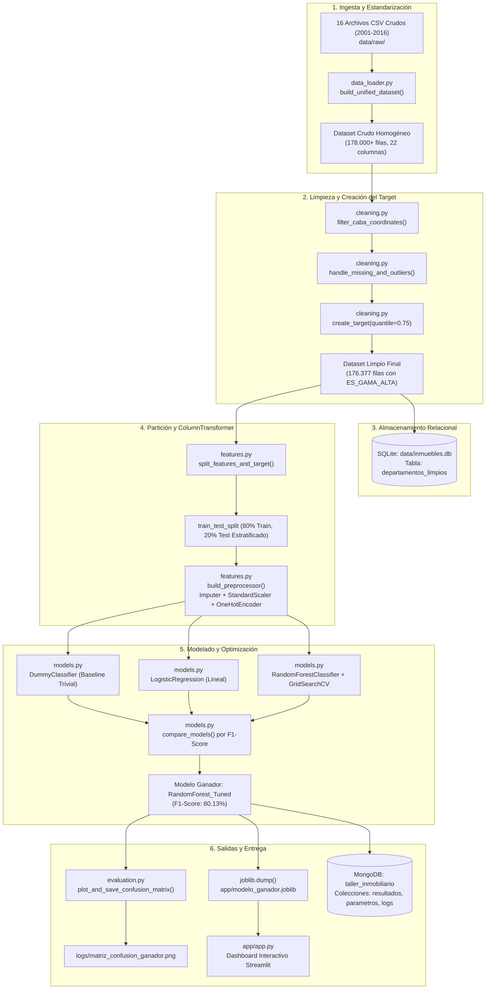
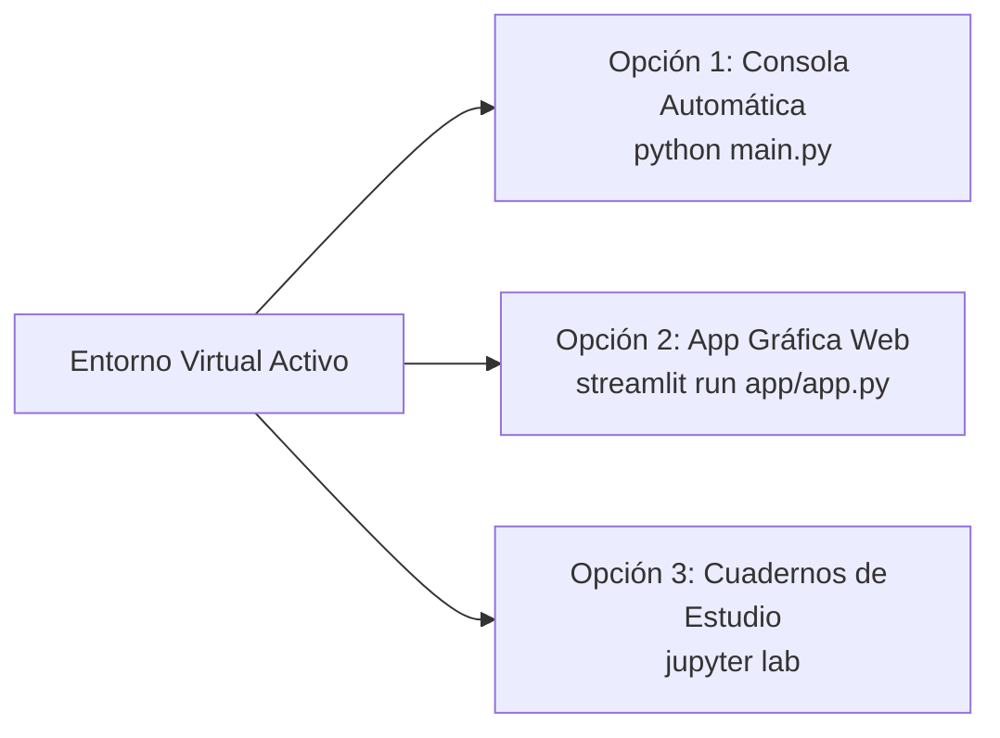
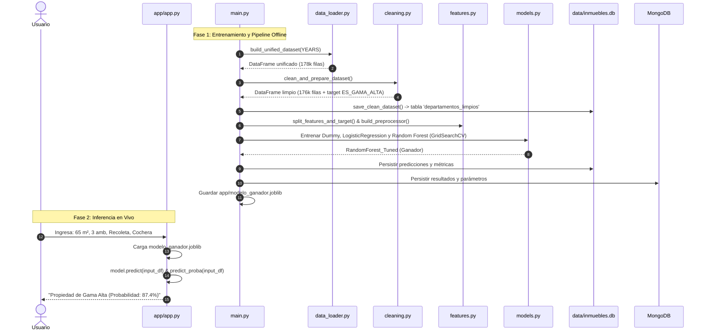
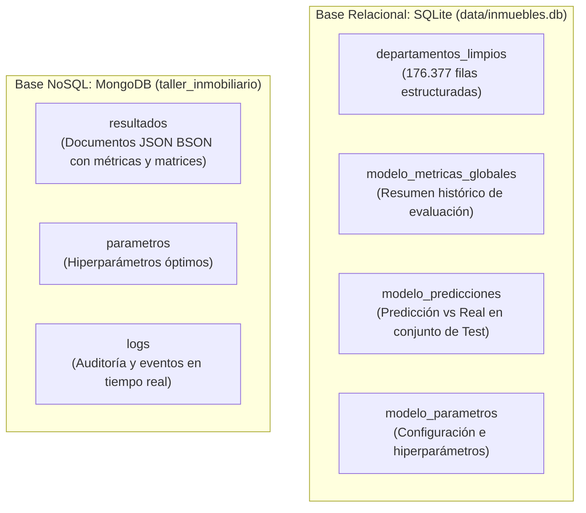

# Manual Técnico y Guía Pedagógica Integral: Pipeline de Ciencia de Datos y Machine Learning de Punta a Punta

**Asignatura:** Programación Avanzada en Ciencia de Datos — Licenciatura en Ciencia de Datos  
**Caso de Estudio:** Tipificación y Clasificación del Mercado Inmobiliario de la Ciudad Autónoma de Buenos Aires (CABA)  
**Nivel:** Educativo, Técnico y Orientado a Producción  
**Versión del Proyecto:** 2.0 (Dual Storage: SQLite + MongoDB + Streamlit Dashboard)

---

## 📑 Tabla de Contenidos

1. [Capítulo 1: Introducción al Proyecto y Caso de Negocio](#capítulo-1-introducción-al-proyecto-y-caso-de-negocio)
2. [Capítulo 2: Tecnologías Utilizadas y Justificación Pedagógica](#capítulo-2-tecnologías-utilizadas-y-justificación-pedagógica)
3. [Capítulo 3: Arquitectura del Sistema y Patrones de Diseño](#capítulo-3-arquitectura-del-sistema-y-patrones-de-diseño)
4. [Capítulo 4: Estructura de Carpetas y Módulos](#capítulo-4-estructura-de-carpetas-y-módulos)
5. [Capítulo 5: Instalación, Requisitos y Configuración del Entorno](#capítulo-5-instalación-requisitos-y-configuración-del-entorno)
6. [Capítulo 6: Guía de Ejecución Paso a Paso](#capítulo-6-guía-de-ejecución-paso-a-paso)
7. [Capítulo 7: Flujo de Datos y Funcionamiento Interno](#capítulo-7-flujo-de-datos-y-funcionamiento-interno)
8. [Capítulo 8: Análisis Detallado del Código Fuente](#capítulo-8-análisis-detallado-del-código-fuente)
9. [Capítulo 9: Bases de Datos (Persistencia Híbrida SQL y NoSQL)](#capítulo-9-bases-de-datos-persistencia-híbrida-sql-y-nosql)
10. [Capítulo 10: Interfaces de Usuario, Comunicación e Inferencia](#capítulo-10-interfaces-de-usuario-comunicación-e-inferencia)
11. [Capítulo 11: Robustez, Manejo de Errores y Seguridad](#capítulo-11-robustez-manejo-de-errores-y-seguridad)
12. [Capítulo 12: Pruebas, Verificación y Depuración (Debugging)](#capítulo-12-pruebas-verificación-y-depuración-debugging)
13. [Capítulo 13: Guía de Modificación y Extensión del Sistema](#capítulo-13-guía-de-modificación-y-extensión-del-sistema)
14. [Capítulo 14: Buenas Prácticas de Ingeniería de Software](#capítulo-14-buenas-prácticas-de-ingeniería-de-software)
15. [Capítulo 15: Laboratorio Práctico: Ejercicios para Estudiantes](#capítulo-15-laboratorio-práctico-ejercicios-para-estudiantes)
16. [Capítulo 16: Glosario Técnico Pedagógico](#capítulo-16-glosario-técnico-pedagógico)

---

## Capítulo 1: Introducción al Proyecto y Caso de Negocio

### 1.1 ¿Qué es este proyecto?
Este proyecto es una solución integral de ingeniería de datos y aprendizaje automático (*Machine Learning*) desarrollada en Python. Su propósito es procesar 16 años de datos históricos de publicaciones de compraventa de inmuebles en la Ciudad Autónoma de Buenos Aires (BA Data, 2001–2016) y entrenar modelos capaces de predecir automáticamente si un departamento pertenece al segmento de **Gama Alta / Lujo** o al segmento **Estándar / Accesible**.

### 1.2 ¿Qué problema resuelve?
En el mercado inmobiliario, el precio publicado por una propiedad es continuo y varía de manera dramática a lo largo del tiempo debido a fenómenos macroeconómicos (devaluaciones, inflación en dólares y cambios de ciclo económico en Argentina entre 2001 y 2016). Una tasación estática fija en dólares queda obsoleta de un año a otro.

Este sistema resuelve tres desafíos críticos:
1. **Unificación Histórica Heterogénea:** Durante 16 años, los organismos públicos cambiaron los nombres de las columnas, formatos de texto, codificaciones y hasta el orden de las coordenadas geográficas (latitud por longitud). El proyecto unifica y limpia más de 178.000 registros bajo un estándar único.
2. **Definición Dinámica de Gama Alta:** Para evitar distorsiones por inflación monetaria en dólares a lo largo de 16 años, clasifica las propiedades evaluando el valor del metro cuadrado en relación con el percentil 75 específico de cada año de publicación.
3. **Productivización del Modelo:** No deja la solución en un archivo de análisis aislado (*notebook*), sino que construye un pipeline modular automatizado, almacena los datos en bases relacionales (SQLite) y NoSQL (MongoDB), y expone un simulador gráfico interactivo con **Streamlit**.

---

## Capítulo 2: Tecnologías Utilizadas y Justificación Pedagógica

| Tecnología | Versión | Rol en el Proyecto | ¿Por qué se utiliza? |
| :--- | :--- | :--- | :--- |
| **Python** | 3.11 / 3.12 | Lenguaje de Programación Base | Estándar de la industria en ciencia de datos por su legibilidad, tipado gradual y rico ecosistema científico. |
| **pandas** | 3.1.1 | Manipulación y análisis tabular | Permite vectorizar transformaciones sobre 178.000 filas de forma veloz y manejar nulos con expresividad. |
| **numpy** | 2.5.4 | Computación numérica matricial | Provee operaciones matemáticas de bajo nivel y soporte para tipos de datos de punto flotante de alta precisión. |
| **scikit-learn** | 1.9.1 | Pipelines y Machine Learning | Contiene los transformadores (`ColumnTransformer`, `StandardScaler`, `OneHotEncoder`) y algoritmos (`LogisticRegression`, `RandomForestClassifier`, `GridSearchCV`). |
| **Streamlit** | 1.67.0 | Frontend Web Interactivo | Permite crear tableros de control y formularios de predicción en tiempo real directamente en Python sin requerir HTML/CSS/JS. |
| **SQLite3** | Estándar Python | Base de Datos Relacional | Motor SQL embebido sin configuración de servidor, ideal para almacenar el dataset limpio de 176.377 registros de manera portable. |
| **PyMongo / MongoDB** | 4.19.0 / v7+ | Base de Datos NoSQL de Documentos | Almacena estructuras dinámicas: métricas de evaluación, árboles de hiperparámetros y logs de auditoría en formato BSON. |
| **Matplotlib & Seaborn** | 3.11.2 / 0.13.2 | Visualización Estadística | Generan la matriz de confusión analítica, distribuciones de frecuencias y heatmaps de correlación exportables en alta resolución (300 DPI). |
| **Joblib** | 1.6.0 | Serialización eficiente | Permite empaquetar el objeto Pipeline de scikit-learn entrenado (`modelo_ganador.joblib`) para su consumo inmediato en producción. |

---

## Capítulo 3: Arquitectura del Sistema y Patrones de Diseño

El sistema sigue el principio de **Separación de Responsabilidades** (*Separation of Concerns - SoC*). Los datos crudos nunca se modifican directamente; viajan a través de etapas puras y desacopladas:



### 3.1 Patrones de Diseño Aplicados
1. **Pipeline Pattern:** Todo el flujo de preprocesamiento y estimación se empaqueta en un objeto `sklearn.pipeline.Pipeline`. Esto garantiza que los datos de prueba (`X_test`) o nuevas propiedades sufran exactamente las mismas transformaciones matemáticas calculadas sobre el set de entrenamiento, eliminando el riesgo de **Fuga de Datos (*Data Leakage*)**.
2. **Single Source of Truth (SSOT):** Toda la configuración de rutas, nombres de columnas canónicas, hiperparámetros por defecto y URIs se ubican exclusivamente en `config.py`.
3. **Graceful Degradation (Fallback Elegante):** Si un estudiante no tiene el servidor de MongoDB instalado localmente, el sistema registra una advertencia informativa y continúa su ejecución guardando en SQLite y en archivos locales sin abortar abruptamente.

---

## Capítulo 4: Estructura de Carpetas y Módulos

```
taller_integrador/
├── .gitignore                     # Filtro de exclusión para Git (.venv, __pycache__, etc.)
├── requirements.txt               # Lista formal de librerías y versiones instaladas
├── README.md                      # Resumen ejecutivo del repositorio y comandos
├── DOCUMENTACION.md               # Este manual integral educativo
├── planificacion.md               # Hoja de ruta y registro de hitos del proyecto
├── config.py                      # Variables globales, constantes de ruta y mapeos
├── main.py                        # Orquestador del pipeline completo por terminal
├── data/
│   ├── raw/                       # 16 archivos CSV originales de BA Data (2001-2016)
│   ├── processed/                 # Almacenamiento intermedio de datasets procesados
│   └── inmuebles.db               # Base de datos SQLite generada con las tablas del TP
├── logs/
│   ├── pipeline.log               # Registro rotativo de eventos de ejecución
│   └── matriz_confusion_ganador.png # Imagen en alta resolución de la matriz de confusión
├── notebooks/
│   ├── 01_eda.ipynb               # Análisis Exploratorio de Datos (distribuciones, nulos)
│   └── 02_modelado.ipynb          # Cuaderno interactivo de experimentación y evaluación
├── src/
│   ├── __init__.py                # Define la carpeta como paquete de Python importable
│   ├── logger_setup.py            # Logger multicanal (Consola + Archivo Rotativo + MongoDB)
│   ├── data_loader.py             # Lectura, estandarización de columnas y validación de coords
│   ├── cleaning.py                # Filtros CABA, remoción de outliers y target anualizado
│   ├── features.py                # Definición modular del ColumnTransformer y splits X/y
│   ├── models.py                  # Definición de pipelines, GridSearchCV y joblib
│   ├── evaluation.py              # Cálculo de métricas (Accuracy, Precision, Recall, F1, ROC-AUC)
│   ├── db_sql.py                  # Conexión, volcado y lectura en SQLite
│   ├── db_mongo.py                # Conexión y volcado de resultados/parámetros en MongoDB
│   └── visualization.py           # Funciones de visualización estadística (heatmaps, barras)
└── app/
    ├── app.py                     # Aplicación web interactiva desarrollada en Streamlit
    └── modelo_ganador.joblib      # Binario serializado con el pipeline de Machine Learning óptimo
```

---

## Capítulo 5: Instalación, Requisitos y Configuración del Entorno

### 5.1 Requisitos Previos
* **Sistema Operativo:** macOS, Linux o Windows 10/11.
* **Python:** Versión 3.11 o 3.12 instalada (`python3 --version`).
* **Git:** Para control de versiones (`git --version`).
* **MongoDB (Opcional):** Si se desea persistencia NoSQL nativa en tiempo real (`mongod --version`). Si no está instalado, el código conmuta automáticamente a almacenamiento local.

### 5.2 Configuración del Entorno Virtual (Paso a Paso)

1. **Abrir la terminal e ingresar a la carpeta del proyecto:**
   ```bash
   cd taller_integrador
   ```

2. **Crear el entorno virtual aislado:**
   Un entorno virtual garantiza que las librerías del proyecto no entren en conflicto con las librerías globales de tu computadora.
   ```bash
   python3 -m venv .venv
   ```

3. **Activar el entorno virtual:**
   * En **macOS / Linux**:
     ```bash
     source .venv/bin/activate
     ```
   * En **Windows (PowerShell)**:
     ```powershell
     .venv\Scripts\Activate.ps1
     ```
   * En **Windows (Símbolo del sistema / CMD)**:
     ```cmd
     .venv\Scripts\activate.bat
     ```
   *(Verificarás que el prompt de tu terminal ahora comienza con `(.venv)`)*.

4. **Actualizar el gestor de paquetes pip:**
   ```bash
   pip install --upgrade pip
   ```

5. **Instalar todas las dependencias del proyecto:**
   ```bash
   pip install -r requirements.txt
   ```

---

## Capítulo 6: Guía de Ejecución Paso a Paso

El proyecto ofrece tres modos complementarios de uso:



### 6.1 Modo 1: Ejecución del Pipeline Automatizado (CLI)
Para correr desde cero todo el pipeline (carga de los 16 años, limpieza, guardado en SQLite, entrenamiento de modelos, optimización con validación cruzada y guardado del modelo ganador):
```bash
python main.py
```
**Resultado esperado en consola:**
```text
==================================================================
 INICIANDO PIPELINE: CLASIFICACIÓN DE PROPIEDADES EN CABA
==================================================================
[Paso 1/8] Cargando y unificando 16 datasets anuales...
Dataset unificado: 178241 filas, 22 columnas
[Paso 2/8] Ejecutando limpieza, tratamiento de outliers y target ES_GAMA_ALTA...
Pipeline de limpieza finalizado con éxito: 176377 filas resultantes.
[Paso 3/8] Persistiendo dataset limpio en SQLite (tabla 'departamentos_limpios')...
[Paso 4/8] Dividiendo datos en Train (80%) y Test (20%) estratificado...
[Paso 5/8] Construyendo ColumnTransformer con imputadores, StandardScaler y OneHotEncoder...
[Paso 6/8] Entrenando Modelo Base Ingenuo: DummyClassifier (Most Frequent)...
[Paso 6/8] Entrenando Modelo 1: Regresión Logística (Baseline Lineal)...
[Paso 6/8] Entrenando Modelo 2: Random Forest con GridSearchCV...
Mejores hiperparámetros: {'classifier__max_depth': 20, 'classifier__n_estimators': 100}
[Paso 7/8] Comparando modelos sobre conjunto de Test...
Modelo ganador seleccionado: 'RandomForest_Tuned' con F1-Score ponderado de 0.8013
[Paso 8/8] Persistiendo resultados y parámetros en MongoDB...
==================================================================
 ¡PIPELINE FINALIZADO CON ÉXITO!
 Modelo Ganador: RandomForest_Tuned
 Accuracy: 0.7926 | Precision: 0.8212 | Recall: 0.7926 | F1-Score: 0.8013
 SQLite: dataset limpio guardado en data/inmuebles.db (tabla 'departamentos_limpios')
 Para lanzar la aplicación web: streamlit run app/app.py
==================================================================
```

### 6.2 Modo 2: Lanzamiento del Dashboard Web (Streamlit)
Una vez entrenado el modelo, lanzá la aplicación interactiva para probar predicciones en vivo:
```bash
streamlit run app/app.py
```
El navegador se abrirá automáticamente en `http://localhost:8501`.

### 6.3 Modo 3: Exploración en Jupyter Notebooks
Para experimentar interactivamente celda por celda:
```bash
jupyter lab
```
Abrí `notebooks/01_eda.ipynb` para ver el análisis exploratorio o `notebooks/02_modelado.ipynb` para comparar modelos paso a paso.

---

## Capítulo 7: Flujo de Datos y Funcionamiento Interno

¿Qué ocurre exactamente desde que los datos se leen del disco hasta que un usuario pide una predicción en Streamlit?



---

## Capítulo 8: Análisis Detallado del Código Fuente

A continuación se analizan los componentes fundamentales de cada módulo del proyecto con fragmentos de código real.

### 8.1 Configuración Centralizada (`config.py`)
Centraliza parámetros inmutables y rutas usando `pathlib.Path`:

```python
# config.py
from pathlib import Path

BASE_DIR = Path(__file__).resolve().parent
DATA_RAW = BASE_DIR / "data" / "raw"
SQLITE_DB_PATH = BASE_DIR / "data" / "inmuebles.db"
SQLITE_TABLE_CLEAN = "departamentos_limpios"

# Normalización de columnas históricas
COLUMN_RENAME_MAP = {
    "LATITUD": "LAT",
    "LONGITUD": "LON",
    "M2CUB": "M2_CUBIERTOS",
    "BAÃOS": "BAÑOS",
    "BAÑO": "BAÑOS",
    "BAUL": "BAULERA",
    "BARRIOS": "BARRIO",
    "A_ESTRENAR": "ES_ESTRENAR",
}
```
* **Concepto pedagógico:** El uso de `Path(__file__).resolve().parent` evita que los scripts fallen si se ejecutan desde otra carpeta en la consola (elimina las rutas relativas frágiles).

---

### 8.2 Ingesta y Detección de Anomalías Geográficas (`src/data_loader.py`)

Uno de los problemas más fascinantes de este dataset real es que en ciertos años (por ejemplo, 2001), los datos de latitud y longitud vinieron invertidos en el CSV de origen:

```python
# src/data_loader.py
def fix_lat_lon(df: pd.DataFrame, year: int) -> pd.DataFrame:
    """Corrige filas donde LAT y LON están invertidas (CABA: lat≈-34.6, lon≈-58.4)."""
    lat = pd.to_numeric(df["LAT"], errors="coerce")
    lon = pd.to_numeric(df["LON"], errors="coerce")
    # Si el valor absoluto de latitud es mayor al de longitud, están cruzadas
    swapped = lat.abs() > lon.abs()
    n = int(swapped.sum())
    if n:
        logger.warning("[%s] %d filas con LAT/LON invertidas, se corrigen", year, n)
    df["LAT"] = np.where(swapped, lon, lat)
    df["LON"] = np.where(swapped, lat, lon)
    return df
```
* **Explicación didáctica:** Buenos Aires se encuentra geográficamente en latitud $\approx -34.6^\circ$ y longitud $\approx -58.4^\circ$. Como $|-34.6| < |-58.4|$, si detectamos que $|LAT| > |LON|$, inequívocamente la columna latitud contenía la longitud y viceversa. La función lo repara de forma vectorizada sin ralentizar la carga con bucles `for`.

---

### 8.3 Limpieza y Creación del Target Anualizado (`src/cleaning.py`)

Para clasificar si una propiedad es "Gama Alta", ¿por qué no fijamos un precio en dólares, por ejemplo $200.000 USD?
Porque en el año 2001 (tras la convertibilidad), un departamento de $150.000 USD era una mansión en Recoleta, mientras que en 2016 correspondía a un dos ambientes promedio.

La solución matemática aplicada es el **umbral dinámico por percentil anual**:

```python
# src/cleaning.py
def create_target(
    df: pd.DataFrame,
    quantile_threshold: float = 0.75,
    target_column_name: str = "ES_GAMA_ALTA",
) -> pd.DataFrame:
    result_df = df.copy()

    # Cálculo del percentil 75 del U$S/m2 agrupado por cada año individual
    threshold_per_year = result_df.groupby("AÑO")["U_S_M2"].transform(
        lambda s: s.quantile(quantile_threshold)
    )

    # Si el valor por m2 supera el percentil de su año -> 1 (Gama Alta), sino 0 (Estándar)
    result_df[target_column_name] = (result_df["U_S_M2"] >= threshold_per_year).astype(int)
    return result_df
```
* **Explicación pedagógica:** La función `.transform()` computa el percentil dentro de cada grupo de año y devuelve una serie del mismo tamaño que el DataFrame original. Así, el modelo evalúa el lujo relativo en el momento de la publicación.

---

### 8.4 Ingeniería de Variables sin Fuga de Datos (`src/features.py`)

```python
# src/features.py
def build_preprocessor() -> ColumnTransformer:
    # Transformador para variables numéricas (m2, ambientes, baños, comodidades)
    numeric_transformer = Pipeline(steps=[
        ("imputer", SimpleImputer(strategy="median")),  # Mediana: no afectada por outliers
        ("scaler", StandardScaler()),                   # z = (x - u) / s
    ])

    # Transformador para variables categóricas (barrio, comuna)
    categorical_transformer = Pipeline(steps=[
        ("imputer", SimpleImputer(strategy="most_frequent")), # Rellena con la moda
        ("onehot", OneHotEncoder(handle_unknown="ignore", sparse_output=False)),
    ])

    return ColumnTransformer(transformers=[
        ("num", numeric_transformer, DEFAULT_NUMERIC_FEATURES),
        ("cat", categorical_transformer, DEFAULT_CATEGORICAL_FEATURES),
    ], remainder="drop")
```

#### ¿Por qué es vital `split_features_and_target`?
```python
def split_features_and_target(df: pd.DataFrame, target_column="ES_GAMA_ALTA"):
    # Se EXCLUYEN deliberadamente 'U_S_M2' y 'DOLARES'
    features = DEFAULT_NUMERIC_FEATURES + DEFAULT_CATEGORICAL_FEATURES
    X = df[features].copy()
    y = df[target_column].copy()
    return X, y
```
> [!IMPORTANT]
> **Prevención de Data Leakage (Fuga de Información):**
> Como la variable objetivo `ES_GAMA_ALTA` fue creada usando `U_S_M2` (que a su vez surge de dividir `DOLARES` por `M2`), si dejamos `U_S_M2` o `DOLARES` dentro de `X`, el modelo memorizaría una fórmula trivial y tendría 100% de acierto ficticio. Al eliminarlas, obligamos al modelo a aprender patrones reales a partir de los metros cuadrados, la cantidad de ambientes, los baños, la antigüedad, las comodidades (cochera, baulera, terraza) y el barrio.

---

### 8.5 Modelado, Validación Cruzada y Selección (`src/models.py`)

El proyecto compara tres niveles de modelado:
1. **Piso Ingenuo (`DummyClassifier`):** Predice siempre la clase mayoritaria (0 = Estándar). Muestra que un modelo con 75% de accuracy puede tener **0% de precisión y recall en la clase minoritaria**, demostrando el peligro de evaluar datos desbalanceados solo con exactitud.
2. **Modelo Paramétrico Lineal (`LogisticRegression`):** Aplica regularización y `class_weight='balanced'` para compensar el desbalance de clases 75/25.
3. **Ensamble No Lineal (`RandomForestClassifier`):** Construye cientos de árboles de decisión en paralelo.

#### Búsqueda de Hiperparámetros con `GridSearchCV`:
```python
# src/models.py
cv = StratifiedKFold(n_splits=3, shuffle=True, random_state=42)
grid_search = GridSearchCV(
    estimator=pipe_rf,
    param_grid={
        "classifier__n_estimators": [50, 100],
        "classifier__max_depth": [10, 20],
    },
    cv=cv,
    scoring="f1_weighted",
    n_jobs=-1,
)
```
* **¿Por qué StratifiedKFold?** Divide el set de entrenamiento en 3 bloques asegurando que en cada uno de ellos la proporción de inmuebles de Gama Alta sea exactamente la misma (25%), evitando sesgos de validación.

---

### 8.6 Evaluación Rigurosa (`src/evaluation.py`)

El sistema evalúa las 4 métricas estándar de clasificación binaria:

$$\text{Accuracy} = \frac{\text{VP} + \text{VN}}{\text{Total}} \quad \text{(Aciertos totales sobre el universo)}$$

$$\text{Precision} = \frac{\text{VP}}{\text{VP} + \text{FP}} \quad \text{(De los que predijo como Lujo, ¿cuántos lo eran realmente?)}$$

$$\text{Recall} = \frac{\text{VP}}{\text{VP} + \text{FN}} \quad \text{(De todos los departamentos de Lujo reales, ¿cuántos descubrió?)}$$

$$\text{F1-Score} = 2 \times \frac{\text{Precision} \times \text{Recall}}{\text{Precision} + \text{Recall}} \quad \text{(Media armónica equilibrada)}$$

---

## Capítulo 9: Bases de Datos (Persistencia Híbrida SQL y NoSQL)

El proyecto utiliza un esquema de **almacenamiento políglota**, asignando a cada motor la tarea en la que mejor se desempeña.



### 9.1 Esquema de Tablas en SQLite (`data/inmuebles.db`)

#### 1. Tabla: `departamentos_limpios`
Almacena el universo total de propiedades normalizadas listas para consultas SQL analíticas.
* Columnas principales: `AÑO` (INT), `BARRIO` (TEXT), `COMUNA` (INT), `M2` (REAL), `AMBIENTES` (REAL), `BAÑOS` (REAL), `ANTIGUEDAD` (REAL), `COCHERA` (INT), `BAULERA` (INT), `TERRAZA` (INT), `LAT` (REAL), `LON` (REAL), `ES_GAMA_ALTA` (INT).

#### 2. Tabla: `modelo_metricas_globales`
Registra el rendimiento histórico obtenido por los modelos evaluados:
```sql
SELECT modelo, accuracy, precision, recall, f1_score, roc_auc 
FROM modelo_metricas_globales 
ORDER BY timestamp DESC LIMIT 1;
```

#### 3. Tabla: `modelo_predicciones`
Contiene la comparación fila por fila sobre el conjunto de test (35.276 registros):
* `id_muestra`: Identificador del registro.
* `clase_real`: Valor original del dataset (0 o 1).
* `clase_predicha`: Decisión del algoritmo (0 o 1).
* `es_acierto`: `1` si coincidieron, `0` si el modelo falló.
* `probabilidad_gama_alta`: Probabilidad continua asignada por el clasificador (entre 0.0 y 1.0).

#### 4. Tabla: `modelo_parametros`
Registra el diccionario JSON devuelto por `GridSearchCV.best_params_`.

---

### 9.2 Esquema de Colecciones en MongoDB (`taller_inmobiliario`)

Si el estudiante tiene MongoDB activo, los datos se guardan como documentos semiestructurados BSON:

```json
// Documento de ejemplo en colección 'resultados'
{
  "_id": ObjectId("65c1f9b87a8b8c1234567890"),
  "timestamp": "2026-11-09T21:32:13.053741",
  "modelo": "RandomForest_Tuned",
  "total_muestras_test": 35276,
  "metricas": {
    "accuracy": 0.7926,
    "precision": 0.8212,
    "recall": 0.7926,
    "f1_score": 0.8013,
    "roc_auc": 0.8556
  },
  "matriz_confusion": [[24210, 2247], [5069, 3750]],
  "muestra_predicciones": [
    {"id": 0, "real": 0, "prediccion": 0, "probabilidad": 0.1824},
    {"id": 1, "real": 1, "prediccion": 1, "probabilidad": 0.8142}
  ]
}
```

---

## Capítulo 10: Interfaces de Usuario, Comunicación e Inferencia

El proyecto dispone de un simulador web en **Streamlit** (`app/app.py`) dividido en tres pestañas didácticas:

1. **Pestaña 1 — Simulador Predictivo:**
   * El usuario ingresa la superficie (m²), cantidad de ambientes, baños, antigüedad, comodidades (cochera, baulera, lavadero, terraza) y barrio de CABA.
   * La aplicación construye un DataFrame unifilar, lo pasa por `modelo_ganador.joblib` y presenta:
     - El segmento predicho: **Gama Alta** o **Estándar**.
     - La barra de certidumbre porcentual calculada mediante `predict_proba()`.
2. **Pestaña 2 — Métricas y Modelo:**
   * Muestra las tarjetas con las métricas oficiales del modelo (Accuracy: 79.26%, Precision: 82.12%, F1-Score: 80.13%).
   * Renderiza la imagen de la matriz de confusión guardada en `logs/matriz_confusion_ganador.png`.
3. **Pestaña 3 — Bases de Datos (SQL & Mongo):**
   * Un visor interactivo de tablas que permite inspeccionar directamente los registros almacenados en SQLite y los documentos en MongoDB sin necesidad de instalar clientes externos como DBeaver o MongoDB Compass.

---

## Capítulo 11: Robustez, Manejo de Errores y Seguridad

### 11.1 Sistema de Logging Multicanal (`src/logger_setup.py`)
El sistema no utiliza simples llamadas a `print()`. En su lugar, implementa un logger profesional con tres destinos:
* **Consola:** Mensajes informativos rápidos formateados para el usuario.
* **Archivo Rotativo (`logs/pipeline.log`):** Guarda hasta 2 MB por archivo con un historial de hasta 3 respaldos (`RotatingFileHandler`).
* **MongoDB (`MongoHandler`):** Inserta eventos directamente en la colección `logs` de forma asíncrona y no bloqueante.

### 11.2 Manejo Seguro de Conexiones
Si MongoDB no está activo, la clase `MongoHandler` y las funciones de `src/db_mongo.py` capturan `ServerSelectionTimeoutError` tras un segundo de espera, deshabilitan las llamadas adicionales y permiten que el pipeline complete su ejecución sin colapsar.

---

## Capítulo 12: Pruebas, Verificación y Depuración (Debugging)

### 12.1 ¿Cómo verificar que todo funciona correctamente?

1. **Comprobar la base de datos SQLite:**
   ```bash
   sqlite3 data/inmuebles.db "SELECT count(*) FROM departamentos_limpios;"
   # Debería devolver aproximadamente 176377
   ```
2. **Verificar el archivo del modelo serializado:**
   ```bash
   ls -lh app/modelo_ganador.joblib
   # Debe existir y ocupar aproximadamente entre 20 MB y 80 MB según la profundidad de los árboles
   ```
3. **Consultar los últimos logs generados:**
   ```bash
   tail -n 20 logs/pipeline.log
   ```

### 12.2 Errores Frecuentes y Cómo Resolverlos

| Mensaje de Error | Causa Probable | Solución Paso a Paso |
| :--- | :--- | :--- |
| `FileNotFoundError: [2008] No se encontró data/raw/departamentos-en-venta-2008.csv` | Falta uno de los 16 archivos anuales en `data/raw/`. | Descargar el CSV correspondiente de BA Data y colocarlo en `data/raw/` respetando el formato de nombre exacto. |
| `MemoryError` o lentitud extrema durante `GridSearchCV` | Explorar demasiadas combinaciones de hiperparámetros en computadoras con poca memoria RAM. | En `main.py`, reducir la muestra de afinado (`sample_size = 10000`) o acotar la grilla a `n_estimators: [50]`. |
| `ModuleNotFoundError: No module named 'src'` al ejecutar un script suelto | Python no encuentra la carpeta raíz en el `sys.path`. | Ejecutar siempre los comandos desde la raíz del proyecto (`python main.py`), o agregar la raíz a `sys.path` como se hace en los notebooks. |
| `Warning: MongoDB no disponible en mongodb://localhost:27017` | El servicio local del motor MongoDB no está encendido. | No es un error bloqueante. El pipeline guardará en SQLite normalmente. Si se desea usar Mongo, iniciar el servicio con `brew services start mongodb-community` o `systemctl start mongod`. |

---

## Capítulo 13: Guía de Modificación y Extensión del Sistema

### 13.1 ¿Cómo agregar una nueva variable predictora?
Supongamos que deseás incorporar la orientación del departamento (`ORIENT`: FRENTE, CONTRAFRENTE):
1. Abrí `config.py` y verificá que `ORIENT` forme parte de `TARGET_COLUMNS`.
2. Abrí `src/features.py` y agregá `"ORIENT"` a la lista `DEFAULT_CATEGORICAL_FEATURES`.
3. El preprocesador `ColumnTransformer` lo tomará automáticamente, imputará los faltantes con la moda y generará las columnas binarias con `OneHotEncoder`.
4. En `app/app.py`, agregá un control desplegable `st.selectbox("Orientación", ["FRENTE", "CONTRAFRENTE"])` dentro del formulario.

### 13.2 ¿Cómo probar un nuevo algoritmo (por ejemplo, XGBoost)?
1. Instalar la librería: `pip install xgboost`.
2. En `src/models.py`, importar `from xgboost import XGBClassifier`.
3. Crear una función constructora del pipeline:
   ```python
   def create_xgboost_pipeline(preprocessor):
       return Pipeline([
           ("preprocessor", preprocessor),
           ("classifier", XGBClassifier(n_estimators=100, max_depth=6, random_state=42))
       ])
   ```
4. Agregarlo al diccionario de candidatos en `main.py`:
   ```python
   candidatos["XGBoost"] = pipe_xgb
   ```
5. Al ejecutar `python main.py`, la función `compare_models` evaluará su F1-Score contra LogisticRegression y Random Forest, eligiendo automáticamente al mejor.

---

## Capítulo 14: Buenas Prácticas de Ingeniería de Software

Este repositorio sirve como modelo pedagógico de cómo trabajar en proyectos de datos profesionales:
1. **Tipado Estático con Type Hints:** Casi todas las funciones cuentan con anotaciones de tipo (`pd.DataFrame`, `Tuple[str, Pipeline]`), facilitando el autocompletado en IDEs como VS Code o PyCharm y previniendo errores de tipo.
2. **Docstrings Estilo Google / PEP 257:** Cada módulo, clase y función documenta sus argumentos (`Args`), valor retornado (`Returns`) y excepciones disparadas (`Raises`).
3. **Inmutabilidad de Datos Crudos:** La carpeta `data/raw/` es de solo lectura. Ningún script sobreescribe los CSVs originales, garantizando que cualquier experimento pueda repetirse desde cero de manera determinista.
4. **Semillas Aleatorias Fijas:** El uso sistemático de `random_state=42` en la partición de datos, validación cruzada y clasificadores garantiza que los resultados sean reproducibles en cualquier computadora.

---

## Capítulo 15: Laboratorio Práctico: Ejercicios para Estudiantes

Para afianzar los conocimientos adquiridos, se propone resolver los siguientes desafíos en orden de complejidad creciente:

### Nivel 1: Inicial (Exploración y SQL)
1. **Ejercicio 1.1:** Abrí SQLite por consola o desde un visor gráfico y escribí una consulta SQL que liste los 5 barrios con mayor porcentaje de propiedades de Gama Alta.
2. **Ejercicio 1.2:** Modificá `config.py` para cambiar el umbral de corte del percentil a `0.80` (el 20% más costoso). Corré el pipeline y observá cómo varían la cantidad de clases y las métricas.

### Nivel 2: Intermedio (Modelado y Preprocesamiento)
1. **Ejercicio 2.1:** En `src/features.py`, modificá el imputador de variables numéricas para probar la estrategia `SimpleImputer(strategy='mean')` en lugar de la mediana. ¿Mejora o empeora el F1-Score frente a valores atípicos?
2. **Ejercicio 2.2:** Agregá a `src/evaluation.py` el cálculo de la métrica **Especificidad (True Negative Rate)**:
   $$\text{Especificidad} = \frac{\text{VN}}{\text{VN} + \text{FP}}$$

### Nivel 3: Avanzado (Ingeniería y Nuevas Características)
1. **Ejercicio 3.1:** Creá una variable derivada sintética (*Feature Engineering*) en `src/cleaning.py`: la relación entre metros cuadrados y cantidad de ambientes (`RATIO_M2_AMBIENTE = M2 / AMBIENTES`). Incorporala al preprocesador y evaluá el impacto en la matriz de confusión.
2. **Ejercicio 3.2:** Creá un script `test_pipeline.py` usando `pytest` que compruebe automáticamente que el dataset limpio no contenga valores nulos en `ES_GAMA_ALTA` y que las coordenadas no tengan valores invertidos.

---

## Capítulo 16: Glosario Técnico Pedagógico

* **Baseline (Línea de Base):** Modelo simple (como predecir siempre la clase mayoritaria o una regresión simple) que sirve como punto de partida para comprobar si un algoritmo más complejo realmente aporta valor.
* **ColumnTransformer:** Objeto de `scikit-learn` que permite aplicar transformaciones diferentes y específicas a distintas columnas de una tabla (por ejemplo, escalar números y codificar texto) en un solo paso.
* **Data Leakage (Fuga de Datos):** Error grave en machine learning donde información que no estaría disponible en el momento de la predicción real se cuela en el entrenamiento, inflando artificialmente las métricas.
* **Ensemble (Ensamble):** Técnica de aprendizaje automático que combina las predicciones de múltiples modelos individuales (como cientos de árboles en Random Forest) para obtener una predicción más robusta y precisa que la de cualquiera de ellos por separado.
* **Hiperparámetro:** Configuración externa de un algoritmo que no se aprende directamente de los datos durante el entrenamiento (por ejemplo, la profundidad máxima de un árbol o la cantidad de árboles), y que debe ser optimizada mediante validación cruzada.
* **Imputación:** Procedimiento estadístico mediante el cual se reemplazan los valores faltantes o nulos (`NaN`) de una columna por un valor representativo (media, mediana o moda).
* **Matriz de Confusión:** Tabla de doble entrada que compara las clases reales contra las clases predichas por el modelo, desglosando los aciertos (Verdaderos Positivos y Verdaderos Negativos) y los errores (Falsos Positivos y Falsos Negativos).
* **One-Hot Encoding:** Técnica de codificación que transforma una columna con categorías de texto (ej: "PALERMO", "CABALLITO") en múltiples columnas binarias de ceros y unos, permitiendo que los algoritmos matemáticos puedan procesarlas sin asumir un orden jerárquico inexistente.
* **Percentil:** Medida de posición estadística que indica el valor por debajo del cual se encuentra un determinado porcentaje de observaciones en un grupo.
* **Pipeline:** Estructura que encadena de forma ordenada y secuencial el preprocesamiento de datos y el estimador final en un único objeto reutilizable.
* **ROC-AUC (Área bajo la Curva ROC):** Métrica que evalúa la capacidad de un clasificador binario para discriminar entre las dos clases a través de todos los posibles umbrales de decisión (1.0 representa discriminación perfecta y 0.5 un clasificador aleatorio).
* **StandardScaler (Estandarización):** Transformación que centra los datos en torno a media 0 y desviación estándar 1 ($z = \frac{x - \mu}{\sigma}$), asegurando que todas las variables numéricas tengan la misma escala.
* **Stratified K-Fold:** Método de validación cruzada que divide el conjunto de datos en $K$ pliegues asegurando que cada uno mantenga exactamente la misma proporción de clases que el dataset completo.
