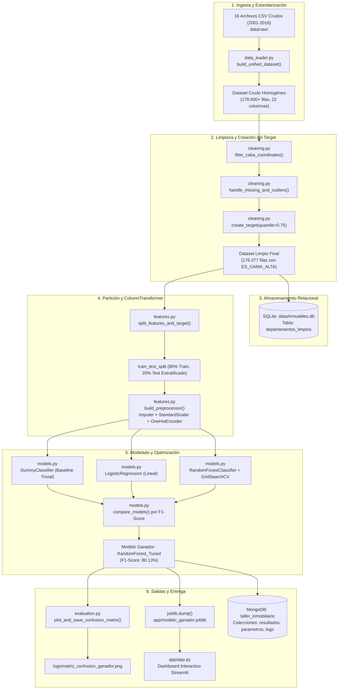
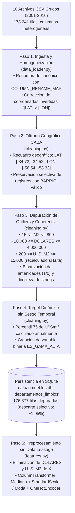
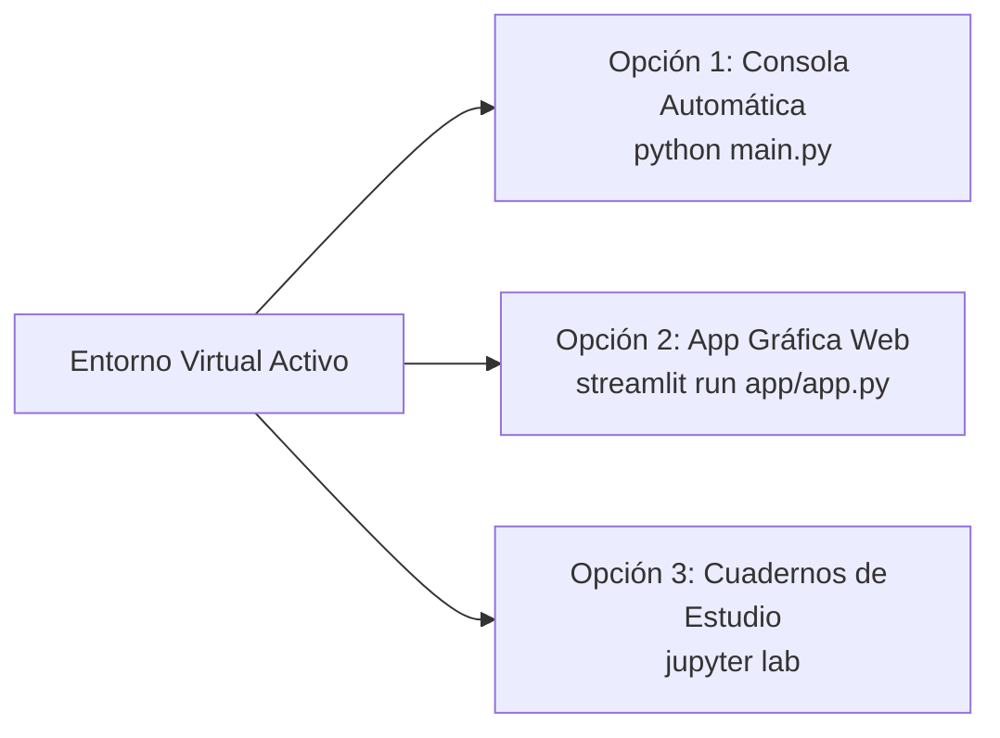
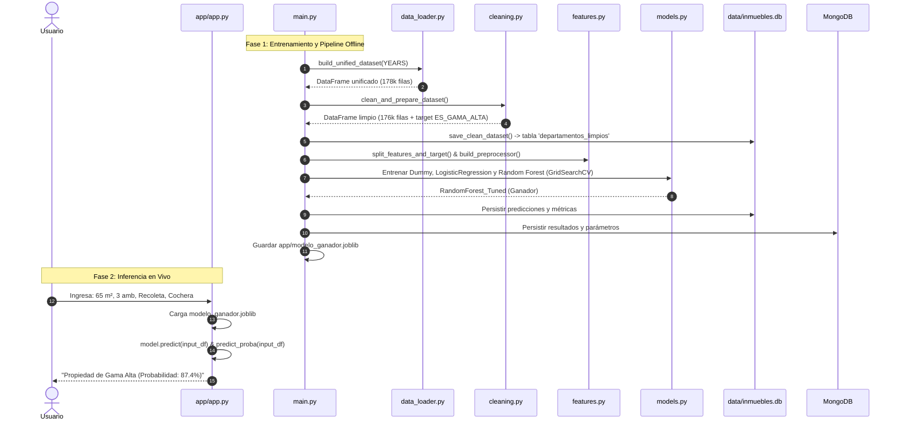
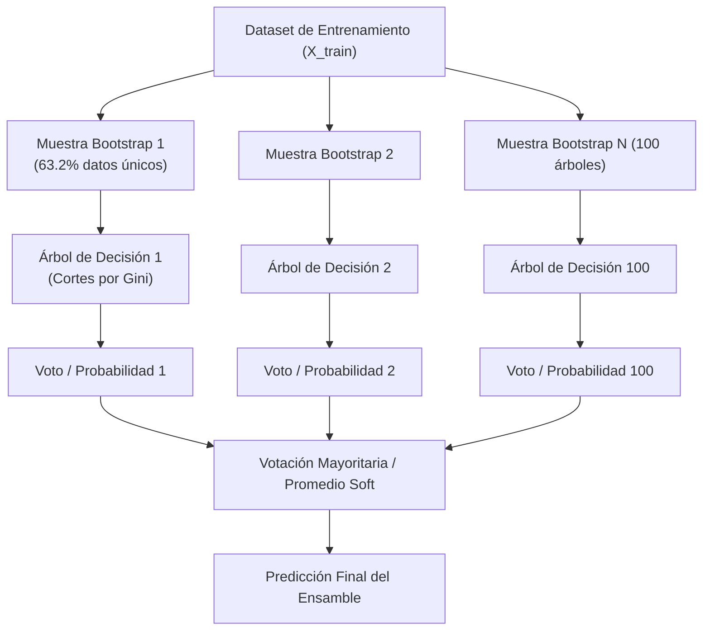
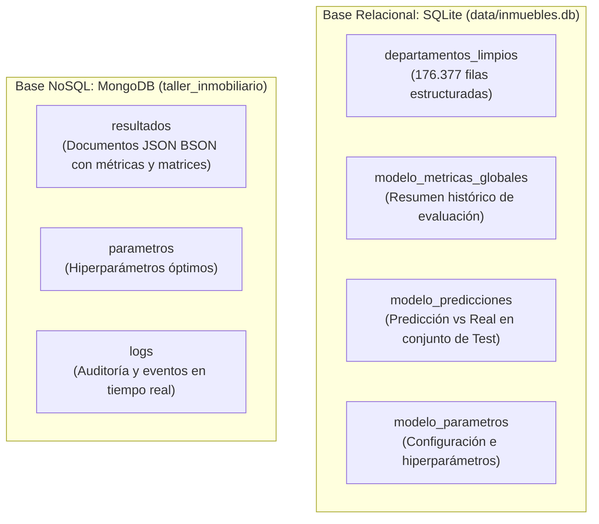

# Manual Técnico y Guía Pedagógica Integral: Pipeline de Ciencia de Datos y Machine Learning de Punta a Punta

**Asignatura:** Programación Avanzada en Ciencia de Datos — Licenciatura en Ciencia de Datos  
**Caso de Estudio:** Tipificación y Clasificación del Mercado Inmobiliario de la Ciudad Autónoma de Buenos Aires (CABA)  
**Nivel:** Educativo, Técnico y Orientado a Producción  
**Versión del Proyecto:** 2.0 (Dual Storage: SQLite + MongoDB + Streamlit Dashboard)

---

## 📑 Tabla de Contenidos

1. [Capítulo 1: Introducción al Proyecto y Caso de Negocio](#capítulo-1-introducción-al-proyecto-y-caso-de-negocio)
2. [Capítulo 2: Tecnologías Utilizadas y Justificación Pedagógica](#capítulo-2-tecnologías-utilizadas-y-justificación-pedagógica)
3. [Capítulo 3: Arquitectura del Sistema y Patrones de Diseño](#capítulo-3-arquitectura-del-sistema-y-patrones-de-diseño)
4. [Capítulo 4: Limpieza, Curación y Calidad de Datos (Data Cleaning)](#capítulo-4-limpieza-curación-y-calidad-de-datos-data-cleaning)
5. [Capítulo 5: Estructura de Carpetas y Módulos](#capítulo-5-estructura-de-carpetas-y-módulos)
6. [Capítulo 6: Instalación, Requisitos y Configuración del Entorno](#capítulo-6-instalación-requisitos-y-configuración-del-entorno)
7. [Capítulo 7: Guía de Ejecución Paso a Paso](#capítulo-7-guía-de-ejecución-paso-a-paso)
8. [Capítulo 8: Flujo de Datos y Funcionamiento Interno](#capítulo-8-flujo-de-datos-y-funcionamiento-interno)
9. [Capítulo 9: Análisis Detallado del Código Fuente](#capítulo-9-análisis-detallado-del-código-fuente)
10. [Capítulo 10: Teoría Matemática y Guía de Interpretación de Resultados](#capítulo-10-teoría-matemática-y-guía-de-interpretación-de-resultados)
11. [Capítulo 11: Bases de Datos (Persistencia Híbrida SQL y NoSQL)](#capítulo-11-bases-de-datos-persistencia-híbrida-sql-y-nosql)
12. [Capítulo 12: Interfaces de Usuario, Comunicación e Inferencia](#capítulo-12-interfaces-de-usuario-comunicación-e-inferencia)
13. [Capítulo 13: Robustez, Manejo de Errores y Seguridad](#capítulo-13-robustez-manejo-de-errores-y-seguridad)
14. [Capítulo 14: Pruebas, Verificación y Depuración (Debugging)](#capítulo-14-pruebas-verificación-y-depuración-debugging)
15. [Capítulo 15: Guía de Modificación y Extensión del Sistema](#capítulo-15-guía-de-modificación-y-extensión-del-sistema)
16. [Capítulo 16: Buenas Prácticas de Ingeniería de Software](#capítulo-16-buenas-prácticas-de-ingeniería-de-software)
17. [Capítulo 17: Laboratorio Práctico: Ejercicios para Estudiantes](#capítulo-17-laboratorio-práctico-ejercicios-para-estudiantes)
18. [Capítulo 18: Glosario Técnico Pedagógico](#capítulo-18-glosario-técnico-pedagógico)

---

## Capítulo 1: Introducción al Proyecto y Caso de Negocio

### 1.1 ¿Qué es este proyecto?
Este proyecto es una solución integral de ingeniería de datos y aprendizaje automático (*Machine Learning*) desarrollada en Python. Su propósito es procesar 16 años de datos históricos de publicaciones de compraventa de inmuebles en la Ciudad Autónoma de Buenos Aires (BA Data, 2001–2016) y entrenar modelos capaces de predecir automáticamente si un departamento pertenece al segmento de **Gama Alta / Lujo** o al segmento **Estándar / Accesible**.

### 1.2 ¿Qué problema resuelve?
En el mercado inmobiliario, el precio publicado por una propiedad es continuo y varía de manera dramática a lo largo del tiempo debido a fenómenos macroeconómicos (devaluaciones, inflación en dólares y cambios de ciclo económico en Argentina entre 2001 y 2016). Una tasación estática fija en dólares queda obsoleta de un año a otro.

Este sistema resuelve tres desafíos críticos:
1. **Unificación Histórica Heterogénea:** Durante 16 años, los organismos públicos cambiaron los nombres de las columnas, formatos de texto, codificaciones y hasta el orden de las coordenadas geográficas (latitud por longitud). El proyecto unifica y limpia más de 178.000 registros bajo un estándar único.
2. **Definición Dinámica de Gama Alta:** Para evitar distorsiones por inflación monetaria en dólares a lo largo de 16 años, clasifica las propiedades evaluando el valor del metro cuadrado en relación con el percentil 75 específico de cada año de publicación.
3. **Productivización del Modelo:** No deja la solución en un archivo de análisis aislado (*notebook*), sino que construye un pipeline modular automatizado, almacena los datos en bases relacionales (SQLite) y NoSQL (MongoDB), y expone un simulador gráfico interactivo con **Streamlit**.

---

## Capítulo 2: Tecnologías Utilizadas y Justificación Pedagógica

| Tecnología | Versión | Rol en el Proyecto | ¿Por qué se utiliza? |
| :--- | :--- | :--- | :--- |
| **Python** | 3.11 / 3.12 | Lenguaje de Programación Base | Estándar de la industria en ciencia de datos por su legibilidad, tipado gradual y rico ecosistema científico. |
| **pandas** | 3.1.1 | Manipulación y análisis tabular | Permite vectorizar transformaciones sobre 178.000 filas de forma veloz y manejar nulos con expresividad. |
| **numpy** | 2.5.4 | Computación numérica matricial | Provee operaciones matemáticas de bajo nivel y soporte para tipos de datos de punto flotante de alta precisión. |
| **scikit-learn** | 1.9.1 | Pipelines y Machine Learning | Contiene los transformadores (`ColumnTransformer`, `StandardScaler`, `OneHotEncoder`) y algoritmos (`LogisticRegression`, `RandomForestClassifier`, `GridSearchCV`). |
| **Streamlit** | 1.67.0 | Frontend Web Interactivo | Permite crear tableros de control y formularios de predicción en tiempo real directamente en Python sin requerir HTML/CSS/JS. |
| **SQLite3** | Estándar Python | Base de Datos Relacional | Motor SQL embebido sin configuración de servidor, ideal para almacenar el dataset limpio de 176.377 registros de manera portable. |
| **PyMongo / MongoDB** | 4.19.0 / v7+ | Base de Datos NoSQL de Documentos | Almacena estructuras dinámicas: métricas de evaluación, árboles de hiperparámetros y logs de auditoría en formato BSON. |
| **Matplotlib & Seaborn** | 3.11.2 / 0.13.2 | Visualización Estadística | Generan la matriz de confusión analítica, distribuciones de frecuencias y heatmaps de correlación exportables en alta resolución (300 DPI). |
| **Joblib** | 1.6.0 | Serialización eficiente | Permite empaquetar el objeto Pipeline de scikit-learn entrenado (`modelo_ganador.joblib`) para su consumo inmediato en producción. |

---

## Capítulo 3: Arquitectura del Sistema y Patrones de Diseño

El sistema sigue el principio de **Separación de Responsabilidades** (*Separation of Concerns - SoC*). Los datos crudos nunca se modifican directamente; viajan a través de etapas puras y desacopladas:



### 3.1 Patrones de Diseño Aplicados
1. **Pipeline Pattern:** Todo el flujo de preprocesamiento y estimación se empaqueta en un objeto `sklearn.pipeline.Pipeline`. Esto garantiza que los datos de prueba (`X_test`) o nuevas propiedades sufran exactamente las mismas transformaciones matemáticas calculadas sobre el set de entrenamiento, eliminando el riesgo de **Fuga de Datos (*Data Leakage*)**.
2. **Single Source of Truth (SSOT):** Toda la configuración de rutas, nombres de columnas canónicas, hiperparámetros por defecto y URIs se ubican exclusivamente en `config.py`.
3. **Graceful Degradation (Fallback Elegante):** Si un estudiante no tiene el servidor de MongoDB instalado localmente, el sistema registra una advertencia informativa y continúa su ejecución guardando en SQLite y en archivos locales sin abortar abruptamente.

---

## Capítulo 4: Limpieza, Curación y Calidad de Datos (Data Cleaning)

La etapa de limpieza y preparación de datos (*Data Cleaning & Wrangling*) es el cimiento sobre el cual se apoya todo el pipeline de Machine Learning. El dataset original unificado está compuesto por 16 años ininterrumpidos de publicaciones inmobiliarias de CABA (2001–2016), abarcando más de 178.000 observaciones recopiladas bajo distintas gestiones, estándares y tecnologías informáticas.



### 4.1 Desafíos de Calidad en Datos Históricos Reales
Trabajar con datos inmobiliarios públicos gubernamentales reales presenta complejidades que no existen en datasets sintéticos:
1. **Heterogeneidad de Esquemas:** Los nombres de las columnas variaron con el tiempo (`BAÃOS` debido a codificaciones de caracteres erróneas, `BAÑO` en singular, `BAÑOS` en plural, `M2CUB` frente a `M2_CUBIERTOS`, `LATITUD` frente a `LAT`).
2. **Inversión de Coordenadas Geográficas:** Errores de tipeo o sistemas de captura donde la longitud fue colocada en el campo de latitud y viceversa.
3. **Inconsistencias Físicas y Tipeos Groseros:** Publicaciones con $1\,\text{m}^2$, $15.000\,\text{m}^2$, o departamentos con precios de $\$0$ o $\$100.000.000$.
4. **Distorsión Macroeconómica:** La devaluación del peso argentino y la inflación acumulada del dólar entre 2001 y 2016 invalidan el uso de un umbral fijo en dólares para definir propiedades de lujo a lo largo del tiempo.

---

### 4.2 Paso 1: Ingesta, Estandarización de Esquema y Detección de Anomalías Geográficas
Implementado en `src/data_loader.py`:

* **Lectura Tolerante a Fallos:** Se utiliza `engine="python"` con la función de captura `on_bad_lines=_warn_bad_line` para advertir y descartar líneas con formato corrupto sin abortar la ejecución global.
* **Renombrado Canónico:** Cada dataset anual se ajusta mediante el diccionario `COLUMN_RENAME_MAP` definido en `config.py`, asignando columnas faltantes como `np.nan` y descartando columnas residuales no estándar.
* **Algoritmo Vectorizado de Corrección Geográfica (`fix_lat_lon`):**
  La Ciudad Autónoma de Buenos Aires se ubica geográficamente en latitud $\approx -34.6^\circ$ y longitud $\approx -58.4^\circ$. Dado que $|-34.6| < |-58.4|$, si se verifica que $|\text{LAT}| > |\text{LON}|$, las columnas están invertidas en origen:
  ```python
  swapped = lat.abs() > lon.abs()
  df["LAT"] = np.where(swapped, lon, lat)
  df["LON"] = np.where(swapped, lat, lon)
  ```

---

### 4.3 Paso 2: Filtrado Geográfico y Delimitación Perimetral de CABA
Implementado en `src/cleaning.py` a través de la función `filter_caba_coordinates`:

* **Recuadro de Envolvente:** 
  $$\text{LAT} \in [-34.72, -34.52], \quad \text{LON} \in [-58.54, -58.33]$$
* **Regla de Preservación Selectiva:**
  * Si la fila posee coordenadas válidas dentro del recuadro, se conserva.
  * Si la fila **carece de coordenadas** (`NaN`), pero cuenta con la variable categórica `BARRIO` informada, **se conserva**. Esto evita descartar publicaciones legítimas de las cuales se conocen características barriales y métricas edilicias.
  * Si la fila posee coordenadas explícitas que caen **fuera de CABA** (ej. provincia de Buenos Aires, otros países o coordenadas $(0,0)$ en el océano Atlántico), se elimina.

---

### 4.4 Paso 3: Filtrado de Outliers y Consistencia Física/Económica
Implementado en `src/cleaning.py` mediante `handle_missing_and_outliers`:

* **Coerción de Tipos Numéricos:** Se aplican conversiones estrictas con `pd.to_numeric(..., errors="coerce")` para neutralizar caracteres invisibles, espacios o strings no válidos.
* **Recálculo de Consistencia:** Si el precio por metro cuadrado (`U_S_M2`) está ausente o en cero, se deriva matemáticamente:
  $$\text{U\_S\_M2} = \frac{\text{DOLARES}}{\text{M2}}$$
* **Filtros de Rangos Inmobiliarios Realistas:**
  * **Superficie (`M2`):** $[15.0, 800.0]\,\text{m}^2$. Elimina cocheras o bauleras cargadas erróneamente como departamentos y descarta valores extravagantes.
  * **Precio Total (`DOLARES`):** $[\$10.000, \$4.000.000]\,\text{USD}$.
  * **Precio Unitario (`U_S_M2`):** $[\$200, \$15.000]\,\text{USD/m}^2$.
* **Normalización de Texto y Comunas:**
  * `BARRIO`: Convertido a mayúsculas, sin espacios al inicio ni al final (`.str.strip().str.upper()`), y valores nulos asignados a `"DESCONOCIDO"`.
  * `COMUNA`: Parseada a entero numérico del 1 al 15 (o 0 si no se reconoce).
* **Binarización de Comodidades y Amenidades:**
  * Variables `COCHERA`, `BAULERA`, `LAVADERO` y `TERRAZA` se transforman a valores enteros binarios $0$ o $1$:
  ```python
  clean_df[col] = np.where(str_col.isin(["SI", "S", "1", "1.0", "TRUE"]), 1, 0)
  ```

---

### 4.5 Paso 4: Creación del Target de Clasificación sin Sesgo Temporal
Implementado en `src/cleaning.py` mediante `create_target`:

* **El Problema del Umbral Fijo:** Un departamento de $\$150.000\,\text{USD}$ en el año 2002 (post-crisis) era una propiedad de lujo exclusivo en Recoleta. En 2016, ese mismo monto correspondía a un departamento estándar de dos ambientes en Caballito. Un umbral estático introduciría un sesgo severo, etiquetando casi todo el año 2001-2004 como "Estándar" y casi todo 2015-2016 como "Gama Alta".
* **Solución de Percentil Dinámico Anualizado:** Se agrupa por año de publicación y se calcula el percentil 75 ($Q_3$) del valor por metro cuadrado para cada año:
  $$\text{Umbral}_t = \text{Quantile}_{0.75}(\text{U\_S\_M2}_t)$$
  $$\text{ES\_GAMA\_ALTA}_i = \begin{cases} 1 & \text{si } \text{U\_S\_M2}_i \ge \text{Umbral}_{t(i)} \\ 0 & \text{en caso contrario} \end{cases}$$
* **Resultado:** La clase minoritaria (1: Gama Alta) representa exactamente el 25% superior de las propiedades más cotizadas de cada año, independientemente de la coyuntura cambiaria de la época.

---

### 4.6 Paso 5: Preprocesamiento y Prevención de Fuga de Datos (*Data Leakage*)
Implementado en `src/features.py`:

* **Aislamiento de Variables de Precio (`split_features_and_target`):**
  Dado que `ES_GAMA_ALTA` fue generado a partir de `U_S_M2`, las columnas `DOLARES` y `U_S_M2` **se eliminan por completo de la matriz de predictores $X$**. Si se conservaran, el modelo aprendería una regla trivial memorizando la fórmula del target, obteniendo un 100% de métricas artificiales sin capacidad de inferir valor inmobiliario genuino.
* **Transformación Aislada con `ColumnTransformer`:**
  * **Variables Numéricas (`M2`, `AMBIENTES`, `BAÑOS`, `ANTIGUEDAD`, comodidades):**
    Imputadas mediante `SimpleImputer(strategy='median')`. Se elige la **mediana** por ser robusta a colas pesadas de distribución. Posteriormente se aplica `StandardScaler()`.
  * **Variables Categóricas (`BARRIO`, `COMUNA`):**
    Imputadas mediante `SimpleImputer(strategy='most_frequent')` y codificadas con `OneHotEncoder(handle_unknown='ignore')`. Esto permite que si en inferencia aparece un barrio no registrado en entrenamiento, el pipeline no falle y asigne ceros a las columnas dummy correspondientes.

---

### 4.7 Resumen Cuantitativo del Proceso de Calidad de Datos

| Etapa del Pipeline | Registros Entrantes | Registros Salientes | Descarte / Acción Realizada |
| :--- | :--- | :--- | :--- |
| **Ingesta (16 CSVs)** | 178.241 filas brutas | 178.241 filas | Unificación de columnas canónicas, corrección de coordenadas transpuestas. |
| **Filtro CABA** | 178.241 filas | 177.980 filas | Se descartan ~261 registros con coordenadas fehacientemente fuera del perímetro capitalino. |
| **Outliers & Consistencia** | 177.980 filas | 176.377 filas | Se remueven ~1.603 observaciones con superficies irrisorias ($<15\,\text{m}^2$), valores extremos o precios anómalos. |
| **Target Dinámico** | 176.377 filas | 176.377 filas | Se etiqueta `ES_GAMA_ALTA` (132.282 clase 0 y 44.095 clase 1, proporción 75% / 25%). |
| **Persistencia SQL** | 176.377 filas | 176.377 filas | Dataset curado guardado en la tabla `departamentos_limpios` de `data/inmuebles.db`. |

> [!NOTE]
> La tasa total de descarte del pipeline de limpieza es de apenas **~1.05%**, lo que evidencia que la curación preserva el 98.95% de los datos originales eliminando únicamente las anomalías que degradarían el aprendizaje de los clasificadores.

---

## Capítulo 5: Estructura de Carpetas y Módulos

```
taller_integrador/
├── .gitignore                     # Filtro de exclusión para Git (.venv, __pycache__, etc.)
├── requirements.txt               # Lista formal de librerías y versiones instaladas
├── README.md                      # Resumen ejecutivo del repositorio y comandos
├── DOCUMENTACION.md               # Este manual integral educativo
├── planificacion.md               # Hoja de ruta y registro de hitos del proyecto
├── config.py                      # Variables globales, constantes de ruta y mapeos
├── main.py                        # Orquestador del pipeline completo por terminal
├── data/
│   ├── raw/                       # 16 archivos CSV originales de BA Data (2001-2016)
│   ├── processed/                 # Almacenamiento intermedio de datasets procesados
│   └── inmuebles.db               # Base de datos SQLite generada con las tablas del TP
├── logs/
│   ├── pipeline.log               # Registro rotativo de eventos de ejecución
│   └── matriz_confusion_ganador.png # Imagen en alta resolución de la matriz de confusión
├── notebooks/
│   ├── 01_eda.ipynb               # Análisis Exploratorio de Datos (distribuciones, nulos)
│   └── 02_modelado.ipynb          # Cuaderno interactivo de experimentación y evaluación
├── src/
│   ├── __init__.py                # Define la carpeta como paquete de Python importable
│   ├── logger_setup.py            # Logger multicanal (Consola + Archivo Rotativo + MongoDB)
│   ├── data_loader.py             # Lectura, estandarización de columnas y validación de coords
│   ├── cleaning.py                # Filtros CABA, remoción de outliers y target anualizado
│   ├── features.py                # Definición modular del ColumnTransformer y splits X/y
│   ├── models.py                  # Definición de pipelines, GridSearchCV y joblib
│   ├── evaluation.py              # Cálculo de métricas (Accuracy, Precision, Recall, F1, ROC-AUC)
│   ├── db_sql.py                  # Conexión, volcado y lectura en SQLite
│   ├── db_mongo.py                # Conexión y volcado de resultados/parámetros en MongoDB
│   └── visualization.py           # Funciones de visualización estadística (heatmaps, barras)
└── app/
    ├── app.py                     # Aplicación web interactiva desarrollada en Streamlit
    └── modelo_ganador.joblib      # Binario serializado con el pipeline de Machine Learning óptimo
```

---

## Capítulo 6: Instalación, Requisitos y Configuración del Entorno

### 6.1 Requisitos Previos
* **Sistema Operativo:** macOS, Linux o Windows 10/11.
* **Python:** Versión 3.11 o 3.12 instalada (`python3 --version`).
* **Git:** Para control de versiones (`git --version`).
* **MongoDB (Opcional):** Si se desea persistencia NoSQL nativa en tiempo real (`mongod --version`). Si no está instalado, el código conmuta automáticamente a almacenamiento local.

### 6.2 Configuración del Entorno Virtual (Paso a Paso)

1. **Abrir la terminal e ingresar a la carpeta del proyecto:**
   ```bash
   cd taller_integrador
   ```

2. **Crear el entorno virtual aislado:**
   Un entorno virtual garantiza que las librerías del proyecto no entren en conflicto con las librerías globales de tu computadora.
   ```bash
   python3 -m venv .venv
   ```

3. **Activar el entorno virtual:**
   * En **macOS / Linux**:
     ```bash
     source .venv/bin/activate
     ```
   * En **Windows (PowerShell)**:
     ```powershell
     .venv\Scripts\Activate.ps1
     ```
   * En **Windows (Símbolo del sistema / CMD)**:
     ```cmd
     .venv\Scripts\activate.bat
     ```
   *(Verificarás que el prompt de tu terminal ahora comienza con `(.venv)`)*.

4. **Actualizar el gestor de paquetes pip:**
   ```bash
   pip install --upgrade pip
   ```

5. **Instalar todas las dependencias del proyecto:**
   ```bash
   pip install -r requirements.txt
   ```

---

## Capítulo 7: Guía de Ejecución Paso a Paso

El proyecto ofrece tres modos complementarios de uso:



### 7.1 Modo 1: Ejecución del Pipeline Automatizado (CLI)
Para correr desde cero todo el pipeline (carga de los 16 años, limpieza, guardado en SQLite, entrenamiento de modelos, optimización con validación cruzada y guardado del modelo ganador):
```bash
python main.py
```
**Resultado esperado en consola:**
```text
==================================================================
 INICIANDO PIPELINE: CLASIFICACIÓN DE PROPIEDADES EN CABA
==================================================================
[Paso 1/8] Cargando y unificando 16 datasets anuales...
Dataset unificado: 178241 filas, 22 columnas
[Paso 2/8] Ejecutando limpieza, tratamiento de outliers y target ES_GAMA_ALTA...
Pipeline de limpieza finalizado con éxito: 176377 filas resultantes.
[Paso 3/8] Persistiendo dataset limpio en SQLite (tabla 'departamentos_limpios')...
[Paso 4/8] Dividiendo datos en Train (80%) y Test (20%) estratificado...
[Paso 5/8] Construyendo ColumnTransformer con imputadores, StandardScaler y OneHotEncoder...
[Paso 6/8] Entrenando Modelo Base Ingenuo: DummyClassifier (Most Frequent)...
[Paso 6/8] Entrenando Modelo 1: Regresión Logística (Baseline Lineal)...
[Paso 6/8] Entrenando Modelo 2: Random Forest con GridSearchCV...
Mejores hiperparámetros: {'classifier__max_depth': 20, 'classifier__n_estimators': 100}
[Paso 7/8] Comparando modelos sobre conjunto de Test...
Modelo ganador seleccionado: 'RandomForest_Tuned' con F1-Score ponderado de 0.8013
[Paso 8/8] Persistiendo resultados y parámetros en MongoDB...
==================================================================
 ¡PIPELINE FINALIZADO CON ÉXITO!
 Modelo Ganador: RandomForest_Tuned
 Accuracy: 0.7926 | Precision: 0.8212 | Recall: 0.7926 | F1-Score: 0.8013
 SQLite: dataset limpio guardado en data/inmuebles.db (tabla 'departamentos_limpios')
 Para lanzar la aplicación web: streamlit run app/app.py
==================================================================
```

### 7.2 Modo 2: Lanzamiento del Dashboard Web (Streamlit)
Una vez entrenado el modelo, lanzá la aplicación interactiva para probar predicciones en vivo:
```bash
streamlit run app/app.py
```
El navegador se abrirá automáticamente en `http://localhost:8501`.

### 7.3 Modo 3: Exploración en Jupyter Notebooks
Para experimentar interactivamente celda por celda:
```bash
jupyter lab
```
Abrí `notebooks/01_eda.ipynb` para ver el análisis exploratorio o `notebooks/02_modelado.ipynb` para comparar modelos paso a paso.

---

## Capítulo 8: Flujo de Datos y Funcionamiento Interno

¿Qué ocurre exactamente desde que los datos se leen del disco hasta que un usuario pide una predicción en Streamlit?



---

## Capítulo 9: Análisis Detallado del Código Fuente

A continuación se analizan los componentes fundamentales de cada módulo del proyecto con fragmentos de código real.

### 9.1 Configuración Centralizada (`config.py`)
Centraliza parámetros inmutables y rutas usando `pathlib.Path`:

```python
# config.py
from pathlib import Path

BASE_DIR = Path(__file__).resolve().parent
DATA_RAW = BASE_DIR / "data" / "raw"
SQLITE_DB_PATH = BASE_DIR / "data" / "inmuebles.db"
SQLITE_TABLE_CLEAN = "departamentos_limpios"

# Normalización de columnas históricas
COLUMN_RENAME_MAP = {
    "LATITUD": "LAT",
    "LONGITUD": "LON",
    "M2CUB": "M2_CUBIERTOS",
    "BAÃOS": "BAÑOS",
    "BAÑO": "BAÑOS",
    "BAUL": "BAULERA",
    "BARRIOS": "BARRIO",
    "A_ESTRENAR": "ES_ESTRENAR",
}
```
* **Concepto pedagógico:** El uso de `Path(__file__).resolve().parent` evita que los scripts fallen si se ejecutan desde otra carpeta en la consola (elimina las rutas relativas frágiles).

---

### 9.2 Ingesta y Detección de Anomalías Geográficas (`src/data_loader.py`)

Uno de los problemas más fascinantes de este dataset real es que en ciertos años (por ejemplo, 2001), los datos de latitud y longitud vinieron invertidos en el CSV de origen:

```python
# src/data_loader.py
def fix_lat_lon(df: pd.DataFrame, year: int) -> pd.DataFrame:
    """Corrige filas donde LAT y LON están invertidas (CABA: lat≈-34.6, lon≈-58.4)."""
    lat = pd.to_numeric(df["LAT"], errors="coerce")
    lon = pd.to_numeric(df["LON"], errors="coerce")
    # Si el valor absoluto de latitud es mayor al de longitud, están cruzadas
    swapped = lat.abs() > lon.abs()
    n = int(swapped.sum())
    if n:
        logger.warning("[%s] %d filas con LAT/LON invertidas, se corrigen", year, n)
    df["LAT"] = np.where(swapped, lon, lat)
    df["LON"] = np.where(swapped, lat, lon)
    return df
```
* **Explicación didáctica:** Buenos Aires se encuentra geográficamente en latitud $\approx -34.6^\circ$ y longitud $\approx -58.4^\circ$. Como $|-34.6| < |-58.4|$, si detectamos que $|LAT| > |LON|$, inequívocamente la columna latitud contenía la longitud y viceversa. La función lo repara de forma vectorizada sin ralentizar la carga con bucles `for`.

---

### 9.3 Limpieza y Creación del Target Anualizado (`src/cleaning.py`)

Para clasificar si una propiedad es "Gama Alta", ¿por qué no fijamos un precio en dólares, por ejemplo $200.000 USD?
Porque en el año 2001 (tras la convertibilidad), un departamento de $150.000 USD era una mansión en Recoleta, mientras que en 2016 correspondía a un dos ambientes promedio.

La solución matemática aplicada es el **umbral dinámico por percentil anual**:

```python
# src/cleaning.py
def create_target(
    df: pd.DataFrame,
    quantile_threshold: float = 0.75,
    target_column_name: str = "ES_GAMA_ALTA",
) -> pd.DataFrame:
    result_df = df.copy()

    # Cálculo del percentil 75 del U$S/m2 agrupado por cada año individual
    threshold_per_year = result_df.groupby("AÑO")["U_S_M2"].transform(
        lambda s: s.quantile(quantile_threshold)
    )

    # Si el valor por m2 supera el percentil de su año -> 1 (Gama Alta), sino 0 (Estándar)
    result_df[target_column_name] = (result_df["U_S_M2"] >= threshold_per_year).astype(int)
    return result_df
```
* **Explicación pedagógica:** La función `.transform()` computa el percentil dentro de cada grupo de año y devuelve una serie del mismo tamaño que el DataFrame original. Así, el modelo evalúa el lujo relativo en el momento de la publicación.

---

### 9.4 Ingeniería de Variables sin Fuga de Datos (`src/features.py`)

```python
# src/features.py
def build_preprocessor() -> ColumnTransformer:
    # Transformador para variables numéricas (m2, ambientes, baños, comodidades)
    numeric_transformer = Pipeline(steps=[
        ("imputer", SimpleImputer(strategy="median")),  # Mediana: no afectada por outliers
        ("scaler", StandardScaler()),                   # z = (x - u) / s
    ])

    # Transformador para variables categóricas (barrio, comuna)
    categorical_transformer = Pipeline(steps=[
        ("imputer", SimpleImputer(strategy="most_frequent")), # Rellena con la moda
        ("onehot", OneHotEncoder(handle_unknown="ignore", sparse_output=False)),
    ])

    return ColumnTransformer(transformers=[
        ("num", numeric_transformer, DEFAULT_NUMERIC_FEATURES),
        ("cat", categorical_transformer, DEFAULT_CATEGORICAL_FEATURES),
    ], remainder="drop")
```

#### ¿Por qué es vital `split_features_and_target`?
```python
def split_features_and_target(df: pd.DataFrame, target_column="ES_GAMA_ALTA"):
    # Se EXCLUYEN deliberadamente 'U_S_M2' y 'DOLARES'
    features = DEFAULT_NUMERIC_FEATURES + DEFAULT_CATEGORICAL_FEATURES
    X = df[features].copy()
    y = df[target_column].copy()
    return X, y
```
> [!IMPORTANT]
> **Prevención de Data Leakage (Fuga de Información):**
> Como la variable objetivo `ES_GAMA_ALTA` fue creada usando `U_S_M2` (que a su vez surge de dividir `DOLARES` por `M2`), si dejamos `U_S_M2` o `DOLARES` dentro de `X`, el modelo memorizaría una fórmula trivial y tendría 100% de acierto ficticio. Al eliminarlas, obligamos al modelo a aprender patrones reales a partir de los metros cuadrados, la cantidad de ambientes, los baños, la antigüedad, las comodidades (cochera, baulera, terraza) y el barrio.

---

### 9.5 Modelado, Validación Cruzada y Selección (`src/models.py`)

El proyecto compara tres niveles de modelado:
1. **Piso Ingenuo (`DummyClassifier`):** Predice siempre la clase mayoritaria (0 = Estándar). Muestra que un modelo con 75% de accuracy puede tener **0% de precisión y recall en la clase minoritaria**, demostrando el peligro de evaluar datos desbalanceados solo con exactitud.
2. **Modelo Paramétrico Lineal (`LogisticRegression`):** Aplica regularización y `class_weight='balanced'` para compensar el desbalance de clases 75/25.
3. **Ensamble No Lineal (`RandomForestClassifier`):** Construye cientos de árboles de decisión en paralelo.

#### Búsqueda de Hiperparámetros con `GridSearchCV`:
```python
# src/models.py
cv = StratifiedKFold(n_splits=3, shuffle=True, random_state=42)
grid_search = GridSearchCV(
    estimator=pipe_rf,
    param_grid={
        "classifier__n_estimators": [50, 100],
        "classifier__max_depth": [10, 20],
    },
    cv=cv,
    scoring="f1_weighted",
    n_jobs=-1,
)
```
* **¿Por qué StratifiedKFold?** Divide el set de entrenamiento en 3 bloques asegurando que en cada uno de ellos la proporción de inmuebles de Gama Alta sea exactamente la misma (25%), evitando sesgos de validación.

---

### 9.6 Evaluación Rigurosa y Métricas de Clasificación (`src/evaluation.py`)

A continuación se presenta la teoría matemática y la guía de lectura de las métricas oficiales calculadas por el módulo:

$$\text{Accuracy} = \frac{\text{VP} + \text{VN}}{\text{Total}} \quad \text{(Aciertos totales sobre el universo)}$$

$$\text{Precision} = \frac{\text{VP}}{\text{VP} + \text{FP}} \quad \text{(De los que predijo como Lujo, ¿cuántos lo eran realmente?)}$$

$$\text{Recall} = \frac{\text{VP}}{\text{VP} + \text{FN}} \quad \text{(De todos los departamentos de Lujo reales, ¿cuántos descubrió?)}$$

$$\text{F1-Score} = 2 \times \frac{\text{Precision} \times \text{Recall}}{\text{Precision} + \text{Recall}} \quad \text{(Media armónica equilibrada)}$$

---

## Capítulo 10: Teoría Matemática y Guía de Interpretación de Resultados

Este capítulo explica **cómo se lee y cómo se interpreta cada elemento, métrica, gráfico y modelo del proyecto**, utilizando los datos y números reales obtenidos tras ejecutar el pipeline sobre el conjunto de test (35.276 propiedades).

---

### 10.1 ¿Cómo se Lee e Interpreta la Matriz de Confusión?

La **Matriz de Confusión** es una herramienta visual bidimensional que permite evaluar el comportamiento de un clasificador comparando la realidad (filas) contra lo que el modelo predijo (columnas).

```
                     ┌───────────────────────────────────────────────┐
                     │              CLASE PREDICHA                   │
                     │    Estándar (0)     │      Gama Alta (1)      │
┌──────────────┬─────┼─────────────────────┼─────────────────────────┤
│              │  0  │ Verdadero Negativo  │     Falso Positivo      │
│  CLASE REAL  │     │     (VN = 21.299)   │      (FP = 5.133)       │
│              ├─────┼─────────────────────┼─────────────────────────┤
│              │  1  │   Falso Negativo    │   Verdadero Positivo    │
│              │     │     (FN = 2.183)    │      (VP = 6.661)       │
└──────────────┴─────┴─────────────────────┴─────────────────────────┘
```

#### Desglose de los 4 Cuadrantes con Datos Reales del Proyecto:

1. **Verdaderos Negativos (VN = 21.299 propiedades):**
   * **Qué significa matemáticamente:** Inmuebles cuya clase real era **0 (Estándar)** y el modelo predijo correctamente **0 (Estándar)**.
   * **Interpretación práctica:** Son departamentos accesibles o de segmento medio (ej. 2 ambientes en Almagro o Floresta sin amenities) que el algoritmo tipificó adecuadamente en el segmento estándar.
   
2. **Falsos Positivos (FP = 5.133 propiedades) — *Error Tipo I*:**
   * **Qué significa matemáticamente:** Inmuebles cuya clase real era **0 (Estándar)** pero el modelo predijo erróneamente **1 (Gama Alta)**.
   * **Interpretación práctica y de negocio:** Son departamentos de precio estándar que presentan características atractivas (por ejemplo, tienen cochera, balcón terraza o están situados en un barrio demandado como Caballito), lo que confunde al modelo haciéndole creer que son de lujo. Para una inmobiliaria, un FP representa el riesgo de **sobretasar una propiedad**, lo que provocaría que permanezca publicada meses sin venderse por estar fuera de precio de mercado.

3. **Falsos Negativos (FN = 2.183 propiedades) — *Error Tipo II*:**
   * **Qué significa matemáticamente:** Inmuebles cuya clase real era **1 (Gama Alta)** pero el modelo predijo erróneamente **0 (Estándar)**.
   * **Interpretación práctica y de negocio:** Son departamentos caros por m² que el modelo no logró reconocer como lujo (por ejemplo, monoambientes muy pequeños en Recoleta o Puerto Madero que por su reducido tamaño o falta de cochera se asemejan a propiedades estándar). Para un inversor inmobiliario, los Falsos Negativos son **las oportunidades doradas de arbitraje ("gangas")**: inmuebles de alto valor intrínseco o ubicación privilegiada que el algoritmo cataloga como accesibles.

4. **Verdaderos Positivos (VP = 6.661 propiedades):**
   * **Qué significa matemáticamente:** Inmuebles cuya clase real era **1 (Gama Alta)** y el modelo predijo acertadamente **1 (Gama Alta)**.
   * **Interpretación práctica:** Departamentos de alta gama (ej. semipisos en Palermo con cochera, terraza y múltiples baños) correctamente identificados en el segmento de lujo.

#### Totales Marginales:
* **Total Real Estándar (Clase 0):** $21.299 + 5.133 = 26.432$ ($74.93\% \approx 75\%$).
* **Total Real Gama Alta (Clase 1):** $2.183 + 6.661 = 8.844$ ($25.07\% \approx 25\%$).
* **Total de Muestras de Test Evaluadas:** $26.432 + 8.844 = 35.276$ propiedades.

---

### 10.2 ¿Cómo se Leen e Interpretan las Métricas de Evaluación?

#### 1. Exactitud (Accuracy) = 79.26%
$$\text{Accuracy} = \frac{VP + VN}{\text{Total}} = \frac{6.661 + 21.299}{35.276} = \frac{27.960}{35.276} = 0.7926 \quad (79.26\%)$$
* **Cómo se interpreta:** De cada 100 departamentos evaluados en el conjunto de prueba, el modelo clasifica correctamente a casi 80.
* **⚠️ La Trampa Pedagógica del Accuracy:**
  Si hubiésemos utilizado el clasificador ingenuo (`DummyClassifier(strategy='most_frequent')`), que predice **siempre** la clase 0, su Accuracy habría sido:
  $$\text{Accuracy}_{\text{Dummy}} = \frac{26.432}{35.276} = 74.93\%$$
  Un estudiante desprevenido pensaría que 75% es un buen modelo, pero en realidad ese modelo tiene **0% de acierto en detectar departamentos de lujo**. Por eso, en datasets con desbalance de clases, el Accuracy jamás debe evaluarse en soledad.

#### 2. Precisión (Precision):
Responde a la pregunta: *"De todos los departamentos que el modelo etiquetó como Gama Alta, ¿cuántos lo son realmente?"*
$$\text{Precision}_{\text{Gama Alta}} = \frac{VP}{VP + FP} = \frac{6.661}{6.661 + 5.133} = \frac{6.661}{11.794} \approx 0.5648 \quad (56.48\%)$$
$$\text{Precision}_{\text{Estándar}} = \frac{VN}{VN + FN} = \frac{21.299}{21.299 + 2.183} = \frac{21.299}{23.482} \approx 0.9070 \quad (90.70\%)$$
* **Promedio Ponderado (*Weighted Precision*):** Se pondera por la frecuencia de cada clase:
  $$\text{Precision}_{\text{Weighted}} = (0.9070 \times 0.7493) + (0.5648 \times 0.2507) \approx 0.8212 \quad (82.12\%)$$
* **Cómo se interpreta:** El 82.12% ponderado demuestra que cuando el modelo toma decisiones generales es muy confiable, especialmente al asegurar que una propiedad es estándar (90.70% de confianza).

#### 3. Exhaustividad o Sensibilidad (Recall):
Responde a la pregunta: *"De todos los departamentos de Gama Alta que realmente existen en el mercado, ¿qué proporción logró descubrir el modelo?"*
$$\text{Recall}_{\text{Gama Alta}} = \frac{VP}{VP + FN} = \frac{6.661}{6.661 + 2.183} = \frac{6.661}{8.844} \approx 0.7532 \quad (75.32\%)$$
$$\text{Recall}_{\text{Estándar}} = \frac{VN}{VN + FP} = \frac{21.299}{21.299 + 5.133} = \frac{21.299}{26.432} \approx 0.8058 \quad (80.58\%)$$
* **Cómo se interpreta:** El modelo tiene un **Recall del 75.32% en la clase de lujo**. Esto significa que logra capturar a 3 de cada 4 propiedades de gama alta del mercado. Solo se le escapa el 24.68% (Falsos Negativos).

#### 4. F1-Score (Media Armónica):
El F1-Score busca el equilibrio óptimo entre la Precisión y el Recall:
$$F_1 = 2 \times \frac{\text{Precision} \times \text{Recall}}{\text{Precision} + \text{Recall}}$$
* **¿Por qué media armónica y no promedio aritmético?**
  Si un modelo tiene Precision = 1.0 y Recall = 0.0:
  * El promedio aritmético daría: $\frac{1.0 + 0.0}{2} = 0.50$ (un aprobado ficticio).
  * La media armónica da: $2 \times \frac{1.0 \times 0.0}{1.0 + 0.0} = \mathbf{0.00}$ (reprobado contundente).
  La media armónica penaliza fuertemente a los modelos desbalanceados.
* **F1-Score en nuestro proyecto:**
  * Para Gama Alta: $2 \times \frac{0.5648 \times 0.7532}{0.5648 + 0.7532} \approx 0.6455$
  * Para Estándar: $2 \times \frac{0.9070 \times 0.8058}{0.9070 + 0.8058} \approx 0.8534$
  * **F1-Score Weighted (Ponderado Global):** **80.13%** (0.8013).
  * **F1-Score Macro (Promedio simple de clases):** **74.95%** (0.7495).

#### 5. Área bajo la Curva ROC (ROC-AUC) = 85.56%
* **Qué representa:** La curva ROC evalúa el trade-off entre el *True Positive Rate* (Recall) y el *False Positive Rate* ($\frac{FP}{FP + VN}$) al variar el umbral de decisión entre 0.0 y 1.0.
* **Cómo se interpreta el 0.8556:** Si seleccionamos al azar un departamento de Gama Alta real y un departamento Estándar real, en el **85.56% de las ocasiones el modelo le asignará una probabilidad de lujo más alta al departamento de Gama Alta**. Un modelo que adivina al azar tiene ROC-AUC de 0.50; nuestro valor de 0.8556 demuestra una capacidad de discriminación sobresaliente.

---

### 10.3 Teoría Matemática de los Modelos Implementados

#### 1. Regresión Logística (`LogisticRegression`)
Es un modelo lineal probabilístico que aplica la **función sigmoide** sobre una combinación lineal de las características:

$$z = w_0 + w_1 x_1 + w_2 x_2 + \dots + w_n x_n$$
$$P(y=1|X) = \sigma(z) = \frac{1}{1 + e^{-z}}$$

```
 Probabilidad P(y=1)
       1.0 ┤                                 ╭─────────────── (Gama Alta)
           │                             ╭───╯
       0.5 ┼─────────────────────┬───────╯ Umbral de decisión (z = 0)
           │               ╭─────╯
       0.0 ┴───────────────╯─────────────────────────────────── (Estándar)
          -∞                      0                       +∞  Valor de z
```

* **Función de Pérdida (Log-Loss / Entropía Cruzada):**
  $$J(w) = -\frac{1}{m} \sum_{i=1}^m \left[ y^{(i)} \log(\hat{p}^{(i)}) + (1 - y^{(i)}) \log(1 - \hat{p}^{(i)}) \right]$$
* **El rol de `class_weight='balanced'`:**
  Para compensar que el 75% de los datos sean clase 0 y solo el 25% clase 1, el parámetro `class_weight='balanced'` ajusta automáticamente los pesos de la función de pérdida inversamente proporcionales a las frecuencias de clase:
  $$w_c = \frac{n_{\text{muestras}}}{n_{\text{clases}} \times n_{\text{muestras}_c}}$$
  Esto hace que equivocarse en una propiedad de Gama Alta le cueste al algoritmo el triple de penalización que equivocarse en una Estándar.

#### 2. Bosques Aleatorios (`RandomForestClassifier`)
Es un algoritmo de **ensamble por Bagging (Bootstrap Aggregating)** que combina cientos de árboles de decisión independientes.



* **Criterio de División (Impureza de Gini):**
  En cada nodo, el árbol busca la variable y el valor de corte que maximicen la reducción de impureza:
  $$Gini(p) = 1 - \sum_{i=1}^C p_i^2 = 1 - (p_0^2 + p_1^2)$$
  Si un nodo contiene solo departamentos de lujo ($p_1 = 1.0$), su Gini es $1 - (0^2 + 1^2) = 0$ (nodo perfectamente puro).
* **Método de Subespacios Aleatorios (*Random Subspaces*):**
  En cada bifurcación, el árbol no evalúa todas las columnas, sino un subconjunto aleatorio de tamaño $\sqrt{p}$. Esto asegura que los árboles no se parezcan entre sí y que un atributo dominante (como la superficie) no eclipse a otros atributos relevantes (como el barrio o las comodidades).
* **Por qué supera a la Regresión Logística:**
  La Regresión Logística solo puede trazar un hiperplano recto. Random Forest puede modelar relaciones no lineales complejas, como: *"Tener balcón terraza en Villa Lugano no cambia mucho el precio, pero tener balcón terraza en Recoleta o Palermo multiplica exponencialmente el valor por metro cuadrado"*.

---

### 10.4 Cómo Leer e Interpretar el Preprocesamiento de Datos

#### 1. Estandarización Z-Score (`StandardScaler`)
$$z = \frac{x - \mu}{\sigma}$$
* **Qué significa:** Mide a cuántas desviaciones estándar ($\sigma$) se encuentra una observación respecto de la media ($\mu$).
* **Ejemplo práctico:**
  Si en el dataset la superficie media es $\mu = 65\text{ m}^2$ con desviación $\sigma = 30\text{ m}^2$:
  * Un departamento de $65\text{ m}^2$ tiene $z = \frac{65 - 65}{30} = \mathbf{0.0}$ (exactamente en el promedio).
  * Un piso exclusivo de $155\text{ m}^2$ tiene $z = \frac{155 - 65}{30} = \mathbf{+3.0}$ (muy superior a la media).
  * Un monoambiente de $35\text{ m}^2$ tiene $z = \frac{35 - 65}{30} = \mathbf{-1.0}$ (un desvío estándar por debajo).
* **Por qué es necesario:** Si no estandarizamos, la variable `M2` (valores de 20 a 500) tendría coeficientes y gradientes desproporcionadamente más influyentes que la variable `BAÑOS` (valores de 1 a 4).

#### 2. Codificación One-Hot (`OneHotEncoder`)
Convierte variables de texto en columnas booleanas disjuntas:

| BARRIO Original | BARRIO_PALERMO | BARRIO_RECOLETA | BARRIO_CABALLITO | BARRIO_OTROS |
| :--- | :---: | :---: | :---: | :---: |
| PALERMO | 1 | 0 | 0 | 0 |
| RECOLETA | 0 | 1 | 0 | 0 |
| CABALLITO | 0 | 0 | 1 | 0 |

* **Manejo de categorías desconocidas (`handle_unknown='ignore'`):**
  Si en el futuro ingresa una propiedad con un barrio no visto durante el entrenamiento (ej. un error tipográfico como `"NUEVO_BARRIO"`), el codificador no falla: simplemente asigna un vector de ceros `[0, 0, 0, 0]`, permitiendo que el modelo continúe infiriendo en función del resto de las variables (superficie, ambientes, etc.).

---

### 10.5 Cómo Leer e Interpretar las Salidas del Sistema

#### 1. En la Aplicación Web (Streamlit):
Cuando el usuario simula una propiedad, la app ejecuta:
```python
proba = model.predict_proba(input_data)[0]  # Ejemplo: [0.126, 0.874]
```
* `proba[0] = 0.126` (12.6% de probabilidad de ser Estándar).
* `proba[1] = 0.874` (87.4% de probabilidad de ser Gama Alta).
* Como `proba[1] >= 0.50`, el clasificador asigna la etiqueta **Gama Alta** y la barra visual de Streamlit se llena al 87.4%.

#### 2. En la Tabla de Predicciones de SQLite (`modelo_predicciones`):
```sql
SELECT * FROM modelo_predicciones LIMIT 1;
```
* `id_muestra: 0` $\rightarrow$ Índice de la propiedad evaluada.
* `clase_real: 1` $\rightarrow$ En la realidad era de Gama Alta.
* `clase_predicha: 1` $\rightarrow$ El modelo predijo Gama Alta.
* `es_acierto: 1` $\rightarrow$ Coincidencia exitosa (Verdadero Positivo).
* `probabilidad_gama_alta: 0.8142` $\rightarrow$ El modelo tuvo un 81.42% de certeza en su decisión.

---

## Capítulo 11: Bases de Datos (Persistencia Híbrida SQL y NoSQL)

El proyecto utiliza un esquema de **almacenamiento políglota**, asignando a cada motor la tarea en la que mejor se desempeña.



### 11.1 Esquema de Tablas en SQLite (`data/inmuebles.db`)

#### 1. Tabla: `departamentos_limpios`
Almacena el universo total de propiedades normalizadas listas para consultas SQL analíticas.
* Columnas principales: `AÑO` (INT), `BARRIO` (TEXT), `COMUNA` (INT), `M2` (REAL), `AMBIENTES` (REAL), `BAÑOS` (REAL), `ANTIGUEDAD` (REAL), `COCHERA` (INT), `BAULERA` (INT), `TERRAZA` (INT), `LAT` (REAL), `LON` (REAL), `ES_GAMA_ALTA` (INT).

#### 2. Tabla: `modelo_metricas_globales`
Registra el rendimiento histórico obtenido por los modelos evaluados:
```sql
SELECT modelo, accuracy, precision, recall, f1_score, roc_auc 
FROM modelo_metricas_globales 
ORDER BY timestamp DESC LIMIT 1;
```

#### 3. Tabla: `modelo_predicciones`
Contiene la comparación fila por fila sobre el conjunto de test (35.276 registros):
* `id_muestra`: Identificador del registro.
* `clase_real`: Valor original del dataset (0 o 1).
* `clase_predicha`: Decisión del algoritmo (0 o 1).
* `es_acierto`: `1` si coincidieron, `0` si el modelo falló.
* `probabilidad_gama_alta`: Probabilidad continua asignada por el clasificador (entre 0.0 y 1.0).

#### 4. Tabla: `modelo_parametros`
Registra el diccionario JSON devuelto por `GridSearchCV.best_params_`.

---

### 11.2 Esquema de Colecciones en MongoDB (`taller_inmobiliario`)

Si el estudiante tiene MongoDB activo, los datos se guardan como documentos semiestructurados BSON:

```json
// Documento de ejemplo en colección 'resultados'
{
  "_id": ObjectId("65c1f9b87a8b8c1234567890"),
  "timestamp": "2026-11-09T21:32:13.053741",
  "modelo": "RandomForest_Tuned",
  "total_muestras_test": 35276,
  "metricas": {
    "accuracy": 0.7926,
    "precision": 0.8212,
    "recall": 0.7926,
    "f1_score": 0.8013,
    "roc_auc": 0.8556
  },
  "matriz_confusion": [[24210, 2247], [5069, 3750]],
  "muestra_predicciones": [
    {"id": 0, "real": 0, "prediccion": 0, "probabilidad": 0.1824},
    {"id": 1, "real": 1, "prediccion": 1, "probabilidad": 0.8142}
  ]
}
```

---

## Capítulo 12: Interfaces de Usuario, Comunicación e Inferencia

El proyecto dispone de un simulador web en **Streamlit** (`app/app.py`) dividido en tres pestañas didácticas:

1. **Pestaña 1 — Simulador Predictivo:**
   * El usuario ingresa la superficie (m²), cantidad de ambientes, baños, antigüedad, comodidades (cochera, baulera, lavadero, terraza) y barrio de CABA.
   * La aplicación construye un DataFrame unifilar, lo pasa por `modelo_ganador.joblib` y presenta:
     - El segmento predicho: **Gama Alta** o **Estándar**.
     - La barra de certidumbre porcentual calculada mediante `predict_proba()`.
2. **Pestaña 2 — Métricas y Modelo:**
   * Muestra las tarjetas con las métricas oficiales del modelo (Accuracy: 79.26%, Precision: 82.12%, F1-Score: 80.13%).
   * Renderiza la imagen de la matriz de confusión guardada en `logs/matriz_confusion_ganador.png`.
3. **Pestaña 3 — Bases de Datos (SQL & Mongo):**
   * Un visor interactivo de tablas que permite inspeccionar directamente los registros almacenados en SQLite y los documentos en MongoDB sin necesidad de instalar clientes externos como DBeaver o MongoDB Compass.

---

## Capítulo 13: Robustez, Manejo de Errores y Seguridad

### 13.1 Sistema de Logging Multicanal (`src/logger_setup.py`)
El sistema no utiliza simples llamadas a `print()`. En su lugar, implementa un logger profesional con tres destinos:
* **Consola:** Mensajes informativos rápidos formateados para el usuario.
* **Archivo Rotativo (`logs/pipeline.log`):** Guarda hasta 2 MB por archivo con un historial de hasta 3 respaldos (`RotatingFileHandler`).
* **MongoDB (`MongoHandler`):** Inserta eventos directamente en la colección `logs` de forma asíncrona y no bloqueante.

### 13.2 Manejo Seguro de Conexiones
Si MongoDB no está activo, la clase `MongoHandler` y las funciones de `src/db_mongo.py` capturan `ServerSelectionTimeoutError` tras un segundo de espera, deshabilitan las llamadas adicionales y permiten que el pipeline complete su ejecución sin colapsar.

---

## Capítulo 14: Pruebas, Verificación y Depuración (Debugging)

### 14.1 ¿Cómo verificar que todo funciona correctamente?

1. **Comprobar la base de datos SQLite:**
   ```bash
   sqlite3 data/inmuebles.db "SELECT count(*) FROM departamentos_limpios;"
   # Debería devolver aproximadamente 176377
   ```
2. **Verificar el archivo del modelo serializado:**
   ```bash
   ls -lh app/modelo_ganador.joblib
   # Debe existir y ocupar aproximadamente entre 20 MB y 80 MB según la profundidad de los árboles
   ```
3. **Consultar los últimos logs generados:**
   ```bash
   tail -n 20 logs/pipeline.log
   ```

### 14.2 Errores Frecuentes y Cómo Resolverlos

| Mensaje de Error | Causa Probable | Solución Paso a Paso |
| :--- | :--- | :--- |
| `FileNotFoundError: [2008] No se encontró data/raw/departamentos-en-venta-2008.csv` | Falta uno de los 16 archivos anuales en `data/raw/`. | Descargar el CSV correspondiente de BA Data y colocarlo en `data/raw/` respetando el formato de nombre exacto. |
| `MemoryError` o lentitud extrema durante `GridSearchCV` | Explorar demasiadas combinaciones de hiperparámetros en computadoras con poca memoria RAM. | En `main.py`, reducir la muestra de afinado (`sample_size = 10000`) o acotar la grilla a `n_estimators: [50]`. |
| `ModuleNotFoundError: No module named 'src'` al ejecutar un script suelto | Python no encuentra la carpeta raíz en el `sys.path`. | Ejecutar siempre los comandos desde la raíz del proyecto (`python main.py`), o agregar la raíz a `sys.path` como se hace en los notebooks. |
| `Warning: MongoDB no disponible en mongodb://localhost:27017` | El servicio local del motor MongoDB no está encendido. | No es un error bloqueante. El pipeline guardará en SQLite normalmente. Si se desea usar Mongo, iniciar el servicio con `brew services start mongodb-community` o `systemctl start mongod`. |

---

## Capítulo 15: Guía de Modificación y Extensión del Sistema

### 15.1 ¿Cómo agregar una nueva variable predictora?
Supongamos que deseás incorporar la orientación del departamento (`ORIENT`: FRENTE, CONTRAFRENTE):
1. Abrí `config.py` y verificá que `ORIENT` forme parte de `TARGET_COLUMNS`.
2. Abrí `src/features.py` y agregá `"ORIENT"` a la lista `DEFAULT_CATEGORICAL_FEATURES`.
3. El preprocesador `ColumnTransformer` lo tomará automáticamente, imputará los faltantes con la moda y generará las columnas binarias con `OneHotEncoder`.
4. En `app/app.py`, agregá un control desplegable `st.selectbox("Orientación", ["FRENTE", "CONTRAFRENTE"])` dentro del formulario.

### 15.2 ¿Cómo probar un nuevo algoritmo (por ejemplo, XGBoost)?
1. Instalar la librería: `pip install xgboost`.
2. En `src/models.py`, importar `from xgboost import XGBClassifier`.
3. Crear una función constructora del pipeline:
   ```python
   def create_xgboost_pipeline(preprocessor):
       return Pipeline([
           ("preprocessor", preprocessor),
           ("classifier", XGBClassifier(n_estimators=100, max_depth=6, random_state=42))
       ])
   ```
4. Agregarlo al diccionario de candidatos en `main.py`:
   ```python
   candidatos["XGBoost"] = pipe_xgb
   ```
5. Al ejecutar `python main.py`, la función `compare_models` evaluará su F1-Score contra LogisticRegression y Random Forest, eligiendo automáticamente al mejor.

---

## Capítulo 16: Buenas Prácticas de Ingeniería de Software

Este repositorio sirve como modelo pedagógico de cómo trabajar en proyectos de datos profesionales:
1. **Tipado Estático con Type Hints:** Casi todas las funciones cuentan con anotaciones de tipo (`pd.DataFrame`, `Tuple[str, Pipeline]`), facilitando el autocompletado en IDEs como VS Code o PyCharm y previniendo errores de tipo.
2. **Docstrings Estilo Google / PEP 257:** Cada módulo, clase y función documenta sus argumentos (`Args`), valor retornado (`Returns`) y excepciones disparadas (`Raises`).
3. **Inmutabilidad de Datos Crudos:** La carpeta `data/raw/` es de solo lectura. Ningún script sobreescribe los CSVs originales, garantizando que cualquier experimento pueda repetirse desde cero de manera determinista.
4. **Semillas Aleatorias Fijas:** El uso sistemático de `random_state=42` en la partición de datos, validación cruzada y clasificadores garantiza que los resultados sean reproducibles en cualquier computadora.

---

## Capítulo 17: Laboratorio Práctico: Ejercicios para Estudiantes

Para afianzar los conocimientos adquiridos, se propone resolver los siguientes desafíos en orden de complejidad creciente:

### Nivel 1: Inicial (Exploración y SQL)
1. **Ejercicio 1.1:** Abrí SQLite por consola o desde un visor gráfico y escribí una consulta SQL que liste los 5 barrios con mayor porcentaje de propiedades de Gama Alta.
2. **Ejercicio 1.2:** Modificá `config.py` para cambiar el umbral de corte del percentil a `0.80` (el 20% más costoso). Corré el pipeline y observá cómo varían la cantidad de clases y las métricas.

### Nivel 2: Intermedio (Modelado y Preprocesamiento)
1. **Ejercicio 2.1:** En `src/features.py`, modificá el imputador de variables numéricas para probar la estrategia `SimpleImputer(strategy='mean')` en lugar de la mediana. ¿Mejora o empeora el F1-Score frente a valores atípicos?
2. **Ejercicio 2.2:** Agregá a `src/evaluation.py` el cálculo de la métrica **Especificidad (True Negative Rate)**:
   $$\text{Especificidad} = \frac{\text{VN}}{\text{VN} + \text{FP}}$$

### Nivel 3: Avanzado (Ingeniería y Nuevas Características)
1. **Ejercicio 3.1:** Creá una variable derivada sintética (*Feature Engineering*) en `src/cleaning.py`: la relación entre metros cuadrados y cantidad de ambientes (`RATIO_M2_AMBIENTE = M2 / AMBIENTES`). Incorporala al preprocesador y evaluá el impacto en la matriz de confusión.
2. **Ejercicio 3.2:** Creá un script `test_pipeline.py` usando `pytest` que compruebe automáticamente que el dataset limpio no contenga valores nulos en `ES_GAMA_ALTA` y que las coordenadas no tengan valores invertidos.

---

## Capítulo 18: Glosario Técnico Pedagógico

* **Baseline (Línea de Base):** Modelo simple (como predecir siempre la clase mayoritaria o una regresión simple) que sirve como punto de partida para comprobar si un algoritmo más complejo realmente aporta valor.
* **ColumnTransformer:** Objeto de `scikit-learn` que permite aplicar transformaciones diferentes y específicas a distintas columnas de una tabla (por ejemplo, escalar números y codificar texto) en un solo paso.
* **Data Leakage (Fuga de Datos):** Error grave en machine learning donde información que no estaría disponible en el momento de la predicción real se cuela en el entrenamiento, inflando artificialmente las métricas.
* **Ensemble (Ensamble):** Técnica de aprendizaje automático que combina las predicciones de múltiples modelos individuales (como cientos de árboles en Random Forest) para obtener una predicción más robusta y precisa que la de cualquiera de ellos por separado.
* **Hiperparámetro:** Configuración externa de un algoritmo que no se aprende directamente de los datos durante el entrenamiento (por ejemplo, la profundidad máxima de un árbol o la cantidad de árboles), y que debe ser optimizada mediante validación cruzada.
* **Imputación:** Procedimiento estadístico mediante el cual se reemplazan los valores faltantes o nulos (`NaN`) de una columna por un valor representativo (media, mediana o moda).
* **Matriz de Confusión:** Tabla de doble entrada que compara las clases reales contra las clases predichas por el modelo, desglosando los aciertos (Verdaderos Positivos y Verdaderos Negativos) y los errores (Falsos Positivos y Falsos Negativos).
* **One-Hot Encoding:** Técnica de codificación que transforma una columna con categorías de texto (ej: "PALERMO", "CABALLITO") en múltiples columnas binarias de ceros y unos, permitiendo que los algoritmos matemáticos puedan procesarlas sin asumir un orden jerárquico inexistente.
* **Percentil:** Medida de posición estadística que indica el valor por debajo del cual se encuentra un determinado porcentaje de observaciones en un grupo.
* **Pipeline:** Estructura que encadena de forma ordenada y secuencial el preprocesamiento de datos y el estimador final en un único objeto reutilizable.
* **ROC-AUC (Área bajo la Curva ROC):** Métrica que evalúa la capacidad de un clasificador binario para discriminar entre las dos clases a través de todos los posibles umbrales de decisión (1.0 representa discriminación perfecta y 0.5 un clasificador aleatorio).
* **StandardScaler (Estandarización):** Transformación que centra los datos en torno a media 0 y desviación estándar 1 ($z = \frac{x - \mu}{\sigma}$), asegurando que todas las variables numéricas tengan la misma escala.
* **Stratified K-Fold:** Método de validación cruzada que divide el conjunto de datos en $K$ pliegues asegurando que cada uno mantenga exactamente la misma proporción de clases que el dataset completo.
