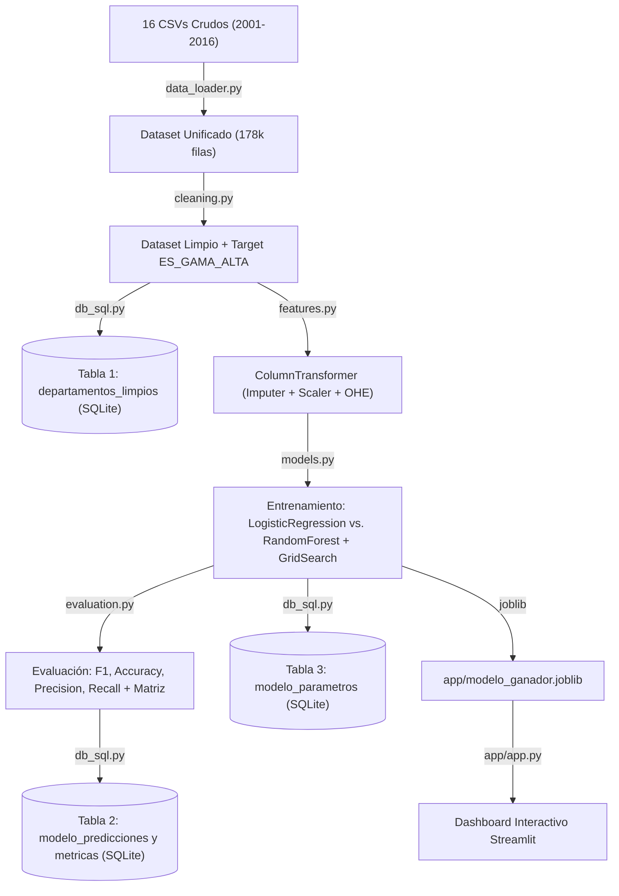

# Guía de Aprendizaje Integral: Proyecto de Ciencia de Datos de Punta a Punta

**Asignatura:** Programación Avanzada en Ciencia de Datos — Licenciatura en Ciencia de Datos  
**Caso de Estudio:** Mercado Inmobiliario de la Ciudad Autónoma de Buenos Aires (CABA)  
**Autoría:** Equipo de Desarrollo / Cátedra  

---

## 🎯 Prólogo: ¿Para quién es este documento?

Este documento fue diseñado especialmente **para cualquier persona que quiera aprender cómo se construye, estructura y defiende un proyecto profesional de Ciencia de Datos y Machine Learning de punta a punta (end-to-end)**.

En lugar de limitarse a mostrar código suelto, esta guía explica **el porqué detrás de cada decisión matemática, metodológica y de ingeniería de software**:
* ¿Por qué usamos módulos `.py` en lugar de programar todo en un solo notebook gigante?
* ¿Cómo se limpian 16 años de datos históricos sin alterar la realidad del mercado?
* ¿Cómo evitamos la temida "fuga de datos" (*data leakage*) al transformar variables?
* ¿Cómo se comparan dos algoritmos de clasificación y cómo se interpretan sus métricas?
* ¿Cómo se conecta un modelo con una base de datos relacional y un dashboard interactivo?

---

## 📑 Índice de Contenidos

1. [El Problema de Negocio y los Datos](#1-el-problema-de-negocio-y-los-datos)
2. [Arquitectura del Proyecto: Modularidad vs. Notebook Monolítico](#2-arquitectura-del-proyecto)
3. [Flujo de Datos Paso a Paso (Pipeline)](#3-flujo-de-datos-paso-a-paso)
   - [Paso 1: Ingesta y Unificación Histórica](#paso-1-ingesta-y-unificación-histórica)
   - [Paso 2: Limpieza, Outliers y Creación del Target](#paso-2-limpieza-outliers-y-creación-del-target)
   - [Paso 3: Ingeniería de Variables y ColumnTransformer](#paso-3-ingeniería-de-variables-y-columntransformer)
   - [Paso 4: Modelado y Optimización con GridSearchCV](#paso-4-modelado-y-optimización-con-gridsearchcv)
   - [Paso 5: Métricas y Matriz de Confusión](#paso-5-métricas-y-matriz-de-confusión)
   - [Paso 6: Persistencia en Base de Datos (SQLite y MongoDB)](#paso-6-persistencia-en-base-de-datos)
   - [Paso 7: Dashboard Interactivo en Streamlit](#paso-7-dashboard-interactivo-en-streamlit)
4. [Conceptos Clave para Entrevistas y Exámenes](#4-conceptos-clave-para-entrevistas-y-exámenes)
5. [Guía Rápida de Comandos](#5-guía-rápida-de-comandos)

---

## 1. El Problema de Negocio y los Datos

### ¿De dónde vienen los datos?
El dataset proviene del **Portal de Datos Abiertos de la Ciudad de Buenos Aires (BA Data)** y reúne publicaciones anuales de departamentos en venta desde el año **2001 hasta 2016** (16 archivos CSV independientes con más de 178.000 registros).

### ¿Por qué Clasificación y no Regresión?
Aunque el precio de venta es una variable continua en dólares, en el mundo real las inmobiliarias, bancos e inversores necesitan **segmentar carteras de propiedades**:
* **Gama Alta / Lujo (Clase 1):** Inmuebles en el percentil superior de cotización por metro cuadrado, con altas prestaciones, ubicaciones prime o comodidades exclusivas.
* **Estándar / Accesible (Clase 0):** Inmuebles de cotización media o de entrada, representativos del mercado general.

Predecir la clase permite automatizar la categorización de publicaciones, detectar oportunidades de inversión y tipificar tasaciones.

---

## 2. Arquitectura del Proyecto

Uno de los errores más comunes al aprender Ciencia de Datos es meter 10.000 líneas de código dentro de un único archivo `.ipynb`. En este proyecto aplicamos **diseño modular orientado a producción**:

```
taller_integrador/
├── config.py                 # Punto único de verdad: rutas, constantes y diccionarios
├── main.py                   # Orquestador del pipeline completo (CLI)
├── app/app.py                # Interfaz gráfica interactiva (Streamlit)
├── data/
│   ├── raw/                  # Datos crudos originales (inmutables)
│   └── inmuebles.db          # Base de datos SQLite con las 3 tablas del TP
├── src/                      # Código modular reusable
│   ├── logger_setup.py       # Registro de eventos (consola y archivo con rotación)
│   ├── data_loader.py        # Lectura, mapeo de columnas y verificación geográfica
│   ├── cleaning.py           # Tratamiento de nulos, outliers y target
│   ├── features.py           # Pipelines scikit-learn (imputación + escalado + OneHot)
│   ├── models.py             # Modelos (LogReg, RandomForest) y GridSearchCV
│   ├── evaluation.py         # Cálculo de Accuracy, Precision, Recall, F1 y confusión
│   ├── db_sql.py             # Persistencia relacional de 3 tablas en SQLite
│   ├── db_mongo.py           # Persistencia de experimentos NoSQL en MongoDB
│   └── visualization.py      # Generación de gráficos analíticos
└── notebooks/
    ├── 01_eda.ipynb          # Análisis exploratorio visual (EDA)
    └── 02_modelado.ipynb     # Comparación interactiva de modelos paso a paso
```

### El rol de los `.ipynb` frente a `src/`:
* **Los módulos en `src/` contienen las funciones puras:** No tienen estado ni gráficos interactivos, pero son testeables, importables y mantenibles.
* **Los notebooks importan de `src/`:** En lugar de reescribir código, el notebook hace `from src.cleaning import clean_and_prepare_dataset` y muestra los resultados y gráficos celda por celda.
* **`main.py` permite la automatización:** Corre el flujo completo con un solo comando en la terminal sin requerir Jupyter.

---

## 3. Flujo de Datos Paso a Paso



---

### Paso 1: Ingesta y Unificación Histórica (`src/data_loader.py`)
* **Problema:** En 16 años, los nombres de las columnas del Gobierno de la Ciudad cambiaron (ej: `LATITUD` en algunos años, `LAT` en otros; `M2CUB` frente a `M2_CUBIERTOS`).
* **Solución:** `config.py` define un mapa de renombre canónico (`COLUMN_RENAME_MAP`). La función `standardize_year()` homologa cada archivo anual a un esquema único de 22 columnas (`TARGET_COLUMNS`).
* **Detección de coordenadas invertidas:** Algunos años tenían Latitud y Longitud intercambiadas. La función `fix_lat_lon()` verifica que `lat ≈ -34.6` y `lon ≈ -58.4` (coordenadas de Buenos Aires). Si detecta inversión, las corrige automáticamente.

---

### Paso 2: Limpieza, Outliers y Creación del Target (`src/cleaning.py`)
* **Depuración geográfica:** Se filtran puntos fuera del rectángulo representativo de CABA (-34.72 a -34.52 de latitud y -58.54 a -58.33 de longitud).
* **Filtro de valores imposibles:** 
  - Superficies menores a 15 m² o mayores a 800 m².
  - Precios menores a 10.000 USD o mayores a 4.000.000 USD.
* **El desafío de la inflación del dólar (2001 vs. 2016):**
  Un departamento de 100.000 dólares en 2001 no tenía el mismo poder adquisitivo ni el mismo valor relativo que en 2016.
  * **Solución matemática:** En lugar de poner un corte fijo en dólares, la función `create_target()` agrupa por `AÑO` y calcula el **percentil 75 del precio por metro cuadrado (`U_S_M2`) de cada año**.
  * Si la propiedad está en el 25% más caro de su año $\rightarrow$ `ES_GAMA_ALTA = 1`.
  * Si está en el 75% restante $\rightarrow$ `ES_GAMA_ALTA = 0`.

---

### Paso 3: Ingeniería de Variables y ColumnTransformer (`src/features.py`)
En Machine Learning, los algoritmos matemáticos no pueden procesar texto en crudo (como nombres de barrios) ni valores nulos.

* **Variables Numéricas (`M2`, `AMBIENTES`, `BAÑOS`, `ANTIGUEDAD`, comodidades):**
  1. `SimpleImputer(strategy='median')`: Si falta la antigüedad o ambientes, rellena con la mediana de la columna. Se usa la mediana porque es inmune a valores extremos.
  2. `StandardScaler()`: Transforma las variables para que tengan media 0 y desviación estándar 1 ($z = \frac{x - \mu}{\sigma}$). Esto evita que la superficie en metros cuadrados (rango 20 a 500) domine artificialmente sobre la cantidad de baños (rango 1 a 4).
* **Variables Categóricas (`BARRIO`, `COMUNA`):**
  1. `SimpleImputer(strategy='most_frequent')`: Rellena nulos con la categoría más común.
  2. `OneHotEncoder(handle_unknown='ignore')`: Convierte cada barrio en una columna binaria (0 o 1). El parámetro `handle_unknown='ignore'` es vital: si mañana ingresa un barrio que el modelo nunca vio, no arroja error, simplemente deja todas sus columnas en cero.
* **Prevención de Data Leakage:**
  El preprocesador **solo se ajusta (`fit`) con los datos de entrenamiento (`X_train`)** y luego únicamente transforma (`transform`) los datos de prueba (`X_test`).

---

### Paso 4: Modelado y Optimización con GridSearchCV (`src/models.py`)

Para garantizar rigor científico, comparamos tres modelos desde el piso ingenuo hasta el ensamble avanzado:

0. **Modelo 0: Clasificador Trivial (`DummyClassifier(strategy='most_frequent')`)**
   * Es el **control experimental o piso de rendimiento**. Predice siempre la clase mayoritaria (Estándar = 0).
   * Al tener el 75% de los datos en clase 0, su Accuracy es del 75%, pero su Precision, Recall y F1 para la clase 1 (Gama Alta) son de **0.00**.
   * Demuestra que un Accuracy alto puede ser un espejismo en datos desbalanceados y establece el piso que cualquier modelo real debe superar.

1. **Modelo 1: Regresión Logística (`LogisticRegression`)**
   * Es un clasificador lineal paramétrico con `class_weight='balanced'`.
   * Modela la probabilidad de que una propiedad sea de gama alta mediante la función sigmoide:
     $$P(y=1|X) = \frac{1}{1 + e^{-(\beta_0 + \beta_1 x_1 + \dots + \beta_n x_n)}}$$
   * Sirve como **baseline paramétrico interpretable**: verifica qué tanto se puede explicar con hiperplanos lineales.

2. **Modelo 2: Bosques Aleatorios (`RandomForestClassifier`)**
   * Es un ensamble no paramétrico de cientos de árboles de decisión independientes entrenados con *bagging* y subespacios aleatorios de variables.
   * Captura interacciones complejas y no lineales (ej: el impacto de la terraza según el barrio).
   * **Optimización con `GridSearchCV`:** Explora sistemáticamente combinaciones de hiperparámetros (`n_estimators`, `max_depth`) usando validación cruzada estratificada (`StratifiedKFold(n_splits=3)`).
   * Supera ampliamente tanto al Dummy como a la Regresión Logística en F1-Score ponderado.

---

### Paso 5: Métricas y Matriz de Confusión (`src/evaluation.py`)

Para clasificar, **el Accuracy (Exactitud) no es suficiente**, especialmente cuando hay desbalance entre clases. Se computan las 4 métricas oficiales:

$$\text{Accuracy} = \frac{VP + VN}{VP + VN + FP + FN}$$
$$\text{Precision} = \frac{VP}{VP + FP} \quad \text{(¿De todos los que predije como Gama Alta, cuántos lo son realmente?)}$$
$$\text{Recall} = \frac{VP}{VP + FN} \quad \text{(¿De todas las propiedades de Gama Alta reales, cuántas detectó el modelo?)}$$
$$\text{F1-Score} = 2 \times \frac{\text{Precision} \times \text{Recall}}{\text{Precision} + \text{Recall}} \quad \text{(Media armónica equilibrada)}$$

* **Matriz de Confusión:** Tabla visual 2x2 que muestra los Verdaderos Positivos (VP), Verdaderos Negativos (VN), Falsos Positivos (FP) y Falsos Negativos (FN).

---

### Paso 6: Persistencia en Base de Datos (`src/db_sql.py` y `src/db_mongo.py`)

Siguiendo la arquitectura definida en `folders.txt`, separamos las responsabilidades de almacenamiento entre base relacional y no relacional:

1. **SQLite (`data/inmuebles.db`) $\rightarrow$ Exclusivamente Dataset Limpio:**
   * Tabla `departamentos_limpios`: Dataset unificado, depurado de outliers y con la variable objetivo `ES_GAMA_ALTA` (176.377 registros listos para consultas SQL estructuradas).
2. **MongoDB (`taller_inmobiliario`) $\rightarrow$ Resultados, Parámetros y Logs:**
   * Colección `resultados`: Métricas globales (Accuracy, Precision, Recall, F1, ROC-AUC) y predicciones detalladas sobre el conjunto de test.
   * Colección `parametros`: Hiperparámetros óptimos seleccionados por `GridSearchCV` y metadatos de configuración.
   * Colección `logs`: Eventos de ejecución registrados en tiempo real a través del `MongoHandler` de `logger_setup.py`.

---

### Paso 7: Dashboard Interactivo en Streamlit (`app/app.py`)

Para que el modelo no quede encerrado en un archivo de texto, implementamos una interfaz gráfica web:
* **Pestaña 1 (Simulador):** Permite a cualquier usuario ingresar los datos de un departamento (superficie, barrio, ambientes, comodidades) y recibir la predicción en tiempo real con una barra de probabilidad porcentual.
* **Pestaña 2 (Métricas):** Exhibe las métricas globales registradas en MongoDB y la imagen de la matriz de confusión guardada.
* **Pestaña 3 (Bases de Datos SQL & Mongo):** Explorador interactivo que permite consultar la tabla de SQLite (`departamentos_limpios`) y las colecciones de MongoDB (`resultados`, `parametros`, `logs`).

---

## 4. Conceptos Clave para Entrevistas y Exámenes

1. **¿Qué es el Data Leakage y cómo se previno en este proyecto?**
   * *Respuesta:* Ocurre cuando información del conjunto de test se "filtra" al entrenamiento. Se previno:
     - Eliminando del entrenamiento variables directamente ligadas al target (`U_S_M2` y `DOLARES`).
     - Creando el `ColumnTransformer` dentro de un `Pipeline` de scikit-learn, garantizando que medias y modas se calculen exclusivamente sobre `X_train`.
2. **¿Por qué usamos `class_weight='balanced'`?**
   * *Respuesta:* Como el 25% de los datos son Gama Alta y el 75% Estándar, un modelo ingenuo podría aprender a predecir siempre "Estándar" y tener 75% de exactitud. `class_weight='balanced'` penaliza con mayor severidad los errores en la clase minoritaria, forzando al modelo a aprender sus características.
3. **¿Por qué `GridSearchCV` se ejecutó sobre una muestra estratificada?**
   * *Respuesta:* Entrenar cientos de árboles con validación cruzada sobre 178.000 filas requiere horas de cómputo. Al extraer una muestra aleatoria estratificada representativa (30.000 filas), encontramos los hiperparámetros óptimos en minutos y luego reentrenamos el modelo definitivo con el 100% de los datos.

---

## 5. Guía Rápida de Comandos

```bash
# 1. Instalar requerimientos
pip install -r requirements.txt

# 2. Correr todo el pipeline (Carga -> Limpieza -> Modelado -> Base de Datos)
python main.py

# 3. Lanzar el dashboard interactivo
streamlit run app/app.py

# 4. Consultar las tablas de la base de datos por consola
sqlite3 data/inmuebles.db "SELECT * FROM modelo_metricas_globales;"
```

