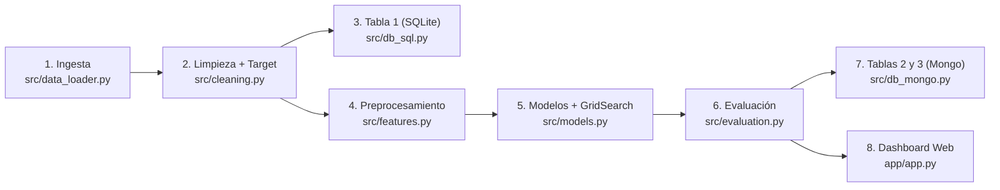
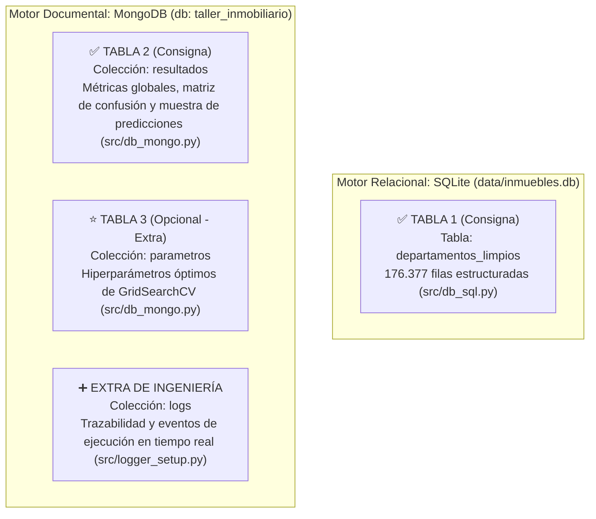

# 🧭 Guía Paso a Paso: Cómo la Consigna del Proyecto Final se Refleja en el Proyecto

**Proyecto:** Clasificación de departamentos de CABA en *Gama Alta* vs. *Estándar* (BA Data 2001–2016)  
**Materia:** Programación Avanzada en Ciencia de Datos — Licenciatura en Ciencia de Datos  
**Propósito de esta guía:** Explicar paso a paso cómo funciona el proyecto y **cómo cada punto, requerimiento técnico y criterio de la rúbrica** del documento oficial (*Proyecto Final: Modelado Predictivo de Clasificación y Pipeline de Datos*) está implementado en nuestro código.

> [!NOTE]
> Esta guía conecta directamente la consigna oficial con los módulos del repositorio y complementa a [DOCUMENTACION.md](file:///Users/fer/Library/CloudStorage/GoogleDrive-f.galera.05@gmail.com/My%20Drive/z%20-%20Licenciatura/3er%20cuatrimestre%202-2026/03%20-%20Programacion%20avanzada/z%20-%20TP/taller_integrador/DOCUMENTACION.md), donde podés consultar el desarrollo matemático extendido y el detalle línea por línea.

---

## 📋 0. Mapa de Trazabilidad: Consigna Oficial → Implementación en el Proyecto

Antes de recorrer el paso a paso, esta matriz resume **dónde y cómo se cumple cada punto del PDF de la consigna**:

| Sección del PDF (Consigna Oficial) | Qué pide la cátedra | Cómo y dónde se refleja en este proyecto |
| :--- | :--- | :--- |
| **1. Objetivo y Dataset** | Elegir entre Opción A (Inmobiliario CABA), B (Energía) o C (Microcréditos) para clasificación binaria/multiclase. | **Opción A seleccionada:** 16 CSVs anuales (2001–2016) de BA Data en `data/raw/`. Clasificación binaria `ES_GAMA_ALTA` (`1` = Gama Alta / Lujo, `0` = Estándar / Accesible) según superficie, barrio, ambientes y prestaciones (`src/data_loader.py` y `src/cleaning.py`). |
| **2.1 Construcción del Modelo (`scikit-learn`)** | `sklearn.pipeline.Pipeline` para preprocesamiento (imputación, escalado, codificación). Comparar ≥ 2 algoritmos y optimizar con `GridSearchCV` o `RandomizedSearchCV`. | `src/features.py` construye el `ColumnTransformer` (`SimpleImputer` + `StandardScaler` + `OneHotEncoder`). `src/models.py` ensambla `Pipeline` completos, compara **3 modelos** (`DummyClassifier`, `LogisticRegression`, `RandomForestClassifier`) y optimiza hiperparámetros con `GridSearchCV` + `StratifiedKFold(n_splits=3)`. |
| **2.2 Evaluación de Desempeño** | Evaluar con **Accuracy, Precision, Recall y F1-Score** + **Matriz de Confusión**. | `src/evaluation.py` calcula `accuracy`, `precision`, `recall`, `f1_score` (ponderado y macro) y `roc_auc`, y exporta la matriz de confusión en `logs/matriz_confusion_ganador.png`. |
| **2.3 Almacenamiento en Base de Datos** | Persistir en BD relacional (SQLite/PostgreSQL) o NoSQL (MongoDB):<br>• **Tabla 1:** Datos limpios<br>• **Tabla 2:** Resultados (predicciones y métricas)<br>• **Tabla 3 (Opcional - Extra):** Configuración y parámetros | **Arquitectura híbrida SQL + NoSQL (incluye el Extra):**<br>• **Tabla 1:** SQLite (`data/inmuebles.db` → tabla `departamentos_limpios`) vía `src/db_sql.py`.<br>• **Tabla 2:** MongoDB (`taller_inmobiliario` → colección `resultados` con métricas globales, matriz y predicciones) vía `src/db_mongo.py`.<br>• **Tabla 3 (Extra):** MongoDB (`colección parametros` con `best_params_` + `colección logs` vía `src/logger_setup.py`). |
| **2.4 Visualización** | Gráficos y tablas claras con `matplotlib`, `seaborn`, `Plotly`, `Power BI` o `Streamlit`. | **Triple capa visual:**<br>1. `src/visualization.py` y `src/evaluation.py` (`matplotlib` + `seaborn`).<br>2. Notebooks `01_eda.ipynb` y `02_modelado.ipynb`.<br>3. App web interactiva en **Streamlit** (`app/app.py`) con simulador, tablero de métricas y visor de bases de datos. |
| **3. Rúbrica y Entregables** | • Código y Git (25%)<br>• BD y visualización (25%)<br>• Modelado y resultados (25%)<br>• Defensa oral 8–10 min / 6–8 filminas (25%) | • Modularización PEP 8, Type Hints, Docstrings, `requirements.txt`, `README.md`, `main.py`.<br>• Persistencia dual y dashboard.<br>• Prevención de *data leakage* y justificación metodológica.<br>• Guion de defensa de 8–10 min incluido en la **Sección 13** de esta guía. |

---

## 1. Elección del Caso de Estudio (Sección 1 del PDF: Opción A)

### Qué pide la consigna
> **Opción A — Mercado Inmobiliario y Tipificación de Propiedades (CABA):**  
> *Dataset:* Propiedades e inmuebles en venta (Portal de Datos Abiertos de la Ciudad de Buenos Aires - BA Data).  
> *Objetivo:* Predecir la categoría/segmento de valor del inmueble (ej. Gama Alta / Lujo vs. Estándar / Accesible) según superficie, barrios y prestaciones.

### Cómo lo resolvemos en el proyecto
Trabajamos con **16 archivos CSV históricos (2001–2016)** ubicados en `data/raw/` (~178.241 registros brutos). Para transformarlos en un problema de clasificación binaria realista tuvimos que resolver tres desafíos técnicos clave:

1. **Datos heterogéneos entre años:** A lo largo de 16 años cambiaron los nombres de columnas (`LATITUD` vs. `LAT`, `BAÃOS` vs. `BAÑOS`, `M2CUB` vs. `M2_CUBIERTOS`) y en algunos períodos se invirtieron por error la latitud y la longitud.
2. **Inflación en dólares y sesgo temporal:** US\$150.000 en 2002 compraban un piso de lujo en Recoleta, pero en 2016 compraban un dos ambientes estándar. Si usáramos un umbral fijo en dólares para todo el dataset, casi todo 2001–2004 sería "Estándar" y casi todo 2015–2016 sería "Gama Alta".
3. **Solución adoptada (Target dinámico anualizado):** Definimos `ES_GAMA_ALTA = 1` cuando el valor del metro cuadrado (`U_S_M2`) del inmueble se ubica en el **25% más caro de su propio año de publicación** (percentil 75 anual, $Q_{0.75}$), y `0` en caso contrario.

💡 **Idea clave para la defensa:** El *target* no viene dado en el CSV; **se diseña con criterio de negocio y estadística** para aislar el efecto macroeconómico de 16 años.

---

## 2. Arquitectura Modular y Buenas Prácticas (Rúbrica: 25% Código y Git)

### Qué pide la consigna
> *"Organización del proyecto, calidad del código (PEP 8), uso de funciones y clases, comentarios y control de versiones en Git/GitHub. Formato de entrega: Código fuente estructurado, script de carga a BD, `requirements.txt` y `README.md`."*

### Cómo está organizado el repositorio



```text
taller_integrador/
├── config.py            # Fuente única de verdad (rutas, columnas canónicas, constantes BD)
├── main.py              # Orquestador punta a punta (ejecuta los 8 pasos en secuencia)
├── requirements.txt     # Dependencias con versiones fijas para reproducibilidad
├── README.md            # Resumen ejecutivo e instrucciones rápidas
├── data/
│   ├── raw/             # 16 CSV originales de BA Data (INMUTABLES / solo lectura)
│   └── inmuebles.db     # Base de datos SQLite generada (Tabla 1: departamentos_limpios)
├── src/                 # Paquete modular con separación de responsabilidades (SoC)
│   ├── data_loader.py   # Lectura tolerante a fallos, mapeo de columnas y fix LAT/LON
│   ├── cleaning.py      # Filtro geográfico CABA, limpieza de outliers y target anual
│   ├── features.py      # Prevención de data leakage, split X/y y ColumnTransformer
│   ├── models.py        # Pipelines scikit-learn, GridSearchCV y serialización joblib
│   ├── evaluation.py    # Accuracy, Precision, Recall, F1, ROC-AUC y Matriz de Confusión
│   ├── db_sql.py        # Persistencia relacional en SQLite (Tabla 1)
│   ├── db_mongo.py      # Persistencia NoSQL en MongoDB (Tabla 2: resultados, Tabla 3: parametros)
│   ├── visualization.py # Gráficos estadísticos con matplotlib y seaborn
│   └── logger_setup.py  # Logging profesional (Consola + Archivo rotativo + MongoDB)
├── notebooks/           # 01_eda.ipynb (Exploración) y 02_modelado.ipynb (Experimentación)
├── app/                 # app.py (Streamlit) + modelo_ganador.joblib
└── logs/                # pipeline.log + matriz_confusion_ganador.png
```

**Decisiones de ingeniería que suman en la rúbrica:**
- **Fuente Única de Verdad (`config.py`):** Usa `Path(__file__).resolve().parent` para que ninguna ruta falle sin importar desde dónde se ejecute el script.
- **Inmutabilidad de `data/raw/`:** Los CSV originales jamás se sobrescriben.
- **Tipado estático y Docstrings:** Todas las funciones tienen *type hints* (`pd.DataFrame`, `Dict[str, Any]`) y docstrings formato Google (PEP 257).
- **Degradación elegante (*Graceful Degradation*):** Si el servicio local de MongoDB está apagado, `src/db_mongo.py` captura la excepción tras un timeout corto (2 s), registra un `WARNING` en el log y continúa sin romper la ejecución.

---

## 3. Paso 1 — Preparación del Entorno y Verificación Inicial

**Objetivo:** Ejecutar el proyecto en un entorno virtual limpio y reproducible.

```bash
cd taller_integrador
python3 --version            # Python 3.11 o 3.12
python3 -m venv .venv
source .venv/bin/activate    # En Windows: .venv\Scripts\Activate.ps1
pip install --upgrade pip
pip install -r requirements.txt
```

✅ **Checkpoint:** Tu terminal muestra `(.venv)` y `python -c "import pandas, sklearn, streamlit, pymongo"` se ejecuta sin errores.

---

## 4. Paso 2 — Análisis Exploratorio de Datos (`notebooks/01_eda.ipynb`)

**Objetivo:** Auditar los datos crudos antes de definir las reglas de limpieza.

Abrí el notebook exploratorio con:
```bash
jupyter lab   # Abrir notebooks/01_eda.ipynb
```

En este notebook se descubren los hallazgos empíricos que justifican el código de `src/data_loader.py` y `src/cleaning.py`:
1. **Esquemas cambiantes:** Columnas con nombres distintos cada año y errores de encoding (`BAÃOS`).
2. **Coordenadas cruzadas:** En años como 2001, `LAT` tiene valores alrededor de `-58.4` y `LON` alrededor de `-34.6`.
3. **Valores extremos irreales:** Departamentos publicados con `1 m²`, `15.000 m²` o precios de `US$ 0`.
4. **Inflación en dólares:** El precio mediano por $\text{m}^2$ se multiplica entre 2002 y 2016.

---

## 5. Paso 3 — Ingesta, Homogeneización y Limpieza (`src/data_loader.py` y `src/cleaning.py`)

**Objetivo:** Transformar los 16 archivos CSV heterogéneos en un dataset curado y consistente (la entrada para la **Tabla 1** de la consigna).

### 5.1 Homogeneización y corrección geográfica (`src/data_loader.py`)
1. **Lectura tolerante a fallos:** Usa `engine="python"` y `on_bad_lines=_warn_bad_line` para registrar y omitir filas malformadas sin abortar la carga.
2. **Estandarización de columnas:** Renombra las variantes históricas usando `COLUMN_RENAME_MAP` de `config.py`.
3. **Corrección vectorizada de coordenadas (`fix_lat_lon`):**  
   En CABA, $\text{lat} \approx -34.6^\circ$ y $\text{lon} \approx -58.4^\circ$. Como $|-34.6| < |-58.4|$, toda fila donde $|\text{LAT}| > |\text{LON}|$ tiene las coordenadas invertidas y se corrige sin usar bucles `for`:
   ```python
   swapped = lat.abs() > lon.abs()
   df["LAT"] = np.where(swapped, lon, lat)
   df["LON"] = np.where(swapped, lat, lon)
   ```

### 5.2 Delimitación de CABA y filtrado de outliers (`src/cleaning.py`)
1. **Filtro geográfico (`filter_caba_coordinates`):** Conserva inmuebles dentro de $\text{LAT} \in [-34.72, -34.52]$ y $\text{LON} \in [-58.54, -58.33]$. Si una propiedad no tiene coordenadas (`NaN`) pero tiene un `BARRIO` válido, **se conserva** para no perder datos útiles.
2. **Coherencia física y económica (`handle_missing_and_outliers`):**
   - Si falta `U_S_M2`, se recalcula como `DOLARES / M2`.
   - Se filtran rangos realistas: `M2` entre `15` y `800`, `DOLARES` entre `10.000` y `4.000.000`, y `U_S_M2` entre `200` y `15.000`.
   - Se normalizan textos (`BARRIO` en mayúsculas y sin espacios) y se binarizan las prestaciones (`COCHERA`, `BAULERA`, `LAVADERO`, `TERRAZA` $\rightarrow 0 / 1$).

### 5.3 Construcción del Target sin sesgo temporal (`create_target`)
$$\text{Umbral}_t = Q_{0.75}(\text{U\_S\_M2}_t) \qquad \text{ES\_GAMA\_ALTA}_i = \mathbb{1}\left[\text{U\_S\_M2}_i \ge \text{Umbral}_{t(i)}\right]$$

```python
threshold_per_year = result_df.groupby("AÑO")["U_S_M2"].transform(
    lambda s: s.quantile(0.75)
)
result_df["ES_GAMA_ALTA"] = (result_df["U_S_M2"] >= threshold_per_year).astype(int)
```

**Balance del proceso de curación:**
- **Entran:** `178.241` filas brutas.
- **Salen:** `176.377` filas limpias (se descarta apenas el **1,05%** de anomalías).
- **Distribución de clases:** `132.282` Estándar (`75%`) y `44.095` Gama Alta (`25%`).

---

## 6. Paso 4 — Construcción del Pipeline de Preprocesamiento (Requerimiento Técnico 1)

### Qué pide la consigna
> *"1. Construcción del Modelo (scikit-learn): Implementar un `sklearn.pipeline.Pipeline` para el preprocesamiento (imputación, escalado, codificación de categóricas)."*

### Cómo se refleja en `src/features.py`

#### 6.1 Prevención estricta de *Data Leakage* (`split_features_and_target`)
Como `ES_GAMA_ALTA` se definió a partir de `U_S_M2` (y éste proviene de `DOLARES / M2`), **se excluyen `DOLARES` y `U_S_M2` de la matriz predictora `X`**. Si quedaran en `X`, el árbol de decisión adivinaría la regla matemática logrando ~100% de acierto ficticio sin aprender nada sobre las características del inmueble.

Las variables predictoras (`X`) son exclusivamente características físicas, de ubicación y prestaciones:
- **Numéricas (`DEFAULT_NUMERIC_FEATURES`):** `M2`, `M2_CUBIERTOS`, `AMBIENTES`, `BAÑOS`, `ANTIGUEDAD`, `COCHERA`, `BAULERA`, `LAVADERO`, `TERRAZA`.
- **Categóricas (`DEFAULT_CATEGORICAL_FEATURES`):** `BARRIO`, `COMUNA`.

#### 6.2 `ColumnTransformer` integrado en el `Pipeline` (`build_preprocessor`)
```python
numeric_transformer = Pipeline(steps=[
    ("imputer", SimpleImputer(strategy="median")),
    ("scaler", StandardScaler()),
])

categorical_transformer = Pipeline(steps=[
    ("imputer", SimpleImputer(strategy="most_frequent")),
    ("onehot", OneHotEncoder(handle_unknown="ignore", sparse_output=False)),
])
```

- **¿Por qué `median` y no `mean`?** La mediana es robusta frente a la asimetría positiva de superficies y antigüedades inmobiliarias.
- **¿Por qué `StandardScaler`?** Lleva cada variable numérica a media 0 y desvío 1 ($z = \frac{x-\mu}{\sigma}$), indispensable para que `M2` (escala de cientos) no domine sobre `BAÑOS` (escala de 1 a 4) en la Regresión Logística.
- **¿Por qué `handle_unknown="ignore"` en `OneHotEncoder`?** Si en producción o en el simulador de Streamlit aparece un barrio no visto en el entrenamiento, el codificador asigna ceros en las variables *dummy* en lugar de lanzar una excepción.
- **¿Por qué hacer `train_test_split` ANTES del `fit`?** En `main.py` primero se divide 80% Train / 20% Test estratificado (`stratify=y`, `random_state=42`) y recién después el `Pipeline` ajusta medianas, medias y desvíos **solo sobre `X_train`**, evitando cualquier fuga de información desde `X_test`.

---

## 7. Paso 5 — Comparación de Algoritmos y Optimización (Requerimiento Técnico 1)

### Qué pide la consigna
> *"Comparar al menos dos algoritmos de clasificación (ej. Logistic Regression, Random Forest, XGBoost) y optimizar hiperparámetros con `GridSearchCV` o `RandomizedSearchCV`."*

### Cómo se refleja en `src/models.py` y `main.py`

En lugar de comparar solo dos algoritmos, el proyecto entrena y compara **tres niveles de complejidad** donde cada uno es un `sklearn.pipeline.Pipeline` completo (`preprocessor` + `classifier`):

| Nivel | Algoritmo en `src/models.py` | Rol metodológico | Configuración clave |
| :-: | :--- | :--- | :--- |
| **0 (Piso)** | `DummyClassifier` | Demostrar la trampa del Accuracy ante clases 75/25 | `strategy="most_frequent"` (predice siempre clase 0) |
| **1 (Lineal)** | `LogisticRegression` | Baseline paramétrico e interpretable | `max_iter=1000`, `class_weight="balanced"` (compensa el 75/25) |
| **2 (Ensamble)** | `RandomForestClassifier` | Capturar relaciones no lineales e interacciones (ej. *terraza × barrio*) | Optimizado con `GridSearchCV` + `StratifiedKFold(n_splits=3)` |

#### Optimización de Hiperparámetros (`optimize_with_gridsearch`)
```python
cv = StratifiedKFold(n_splits=3, shuffle=True, random_state=42)
param_grid = {
    "classifier__n_estimators": [50, 100],
    "classifier__max_depth": [10, 20],
}
grid_search = GridSearchCV(
    estimator=pipe_rf,
    param_grid=param_grid,
    cv=cv,
    scoring="f1_weighted",
    n_jobs=-1,
)
```
- **Resultado del ajuste:** Los mejores hiperparámetros hallados son `{'classifier__max_depth': 20, 'classifier__n_estimators': 100}`.
- **Selección automática (`compare_models`):** Evalúa todos los candidatos sobre `X_test` (`35.276` propiedades) y corona ganador a `RandomForest_Tuned` por obtener el mayor **F1-Score ponderado (`0.8013`)**.

---

## 8. Paso 6 — Evaluación de Desempeño y Matriz de Confusión (Requerimiento Técnico 2)

### Qué pide la consigna
> *"2. Evaluación de Desempeño: Evaluar los modelos utilizando las métricas: **Accuracy, Precision, Recall y F1-Score**, acompañadas por la **Matriz de Confusión** correspondiente."*

### Cómo se refleja en `src/evaluation.py` y cómo defender los resultados

Sobre el conjunto de prueba independiente (`35.276` departamentos: `26.432` Estándar y `8.844` Gama Alta), el modelo ganador (`RandomForest_Tuned`) arroja la siguiente **Matriz de Confusión** (guardada automáticamente en `logs/matriz_confusion_ganador.png`):

| | Predicción: Estándar (0) | Predicción: Gama Alta (1) | Total Real |
| :--- | :---: | :---: | :---: |
| **Real: Estándar (0)** | **VN = 21.299** | **FP = 5.133** *(Error Tipo I)* | 26.432 (74,93%) |
| **Real: Gama Alta (1)** | **FN = 2.183** *(Error Tipo II)* | **VP = 6.661** | 8.844 (25,07%) |

#### Tabla Comparativa de las 4 Métricas Obligatorias (+ ROC-AUC)

| Métrica exigida | Fórmula | Valor Global (Ponderado) | Valor en Clase Gama Alta (1) | Interpretación para la defensa oral |
| :--- | :--- | :---: | :---: | :--- |
| **Accuracy** | $\frac{VP+VN}{\text{Total}}$ | **79,26%** | — | Clasifica bien casi 8 de cada 10 inmuebles. Supera al piso ingenuo (`74,93%`) que no detectaba ningún lujo. |
| **Precision** | $\frac{VP}{VP+FP}$ | **82,12%** | **56,48%** | Ponderada es alta por el 90,7% en clase Estándar. En Gama Alta indica que de cada 100 predichos como lujo, ~56 lo son realmente. |
| **Recall** | $\frac{VP}{VP+FN}$ | **79,26%** | **75,32%** | **Punto fuerte del modelo:** detecta **3 de cada 4** propiedades de Gama Alta reales del mercado (`6.661` de `8.844`). |
| **F1-Score** | $2\cdot\frac{P\cdot R}{P+R}$ | **80,13%** | **64,55%** | Media armónica que equilibra Precision y Recall (F1 Macro = `74,95%`). |
| **ROC-AUC** *(Extra)* | Área bajo curva ROC | **85,56%** | **85,56%** | Excelente capacidad de discriminación probabilística en todos los umbrales de corte. |

💡 **Lectura de negocio de los errores:**
- **Falso Positivo (`5.133` casos):** Departamentos estándar con muy buenas prestaciones (ej. cochera y terraza en un barrio medio) que el modelo clasifica como Gama Alta. En el negocio inmobiliario equivale al riesgo de **sobretasar**.
- **Falso Negativo (`2.183` casos):** Departamentos caros por $\text{m}^2$ pero pequeños o sin amenities que el modelo clasifica como Estándar. Para un inversor representan **oportunidades de compra subvaluadas ("gangas")**.

---

## 9. Paso 7 — Almacenamiento e Integración con Bases de Datos (Requerimiento Técnico 3)

### Qué pide la consigna
> *"3. Almacenamiento e Integración con Base de Datos: Persistir la información en una base de datos relacional (SQLite, PostgreSQL) o NoSQL (MongoDB). La BD debe incluir:*  
> *• **Tabla 1:** Datos de entrada limpios y preprocesados.*  
> *• **Tabla 2:** Resultados del modelo (predicciones y métricas globales).*  
> *• **Tabla 3 (Opcional - Extra):** Configuración y parametrización del modelo."*

### Cómo superamos el requerimiento: Arquitectura Políglota (SQLite + MongoDB)

En lugar de elegir solo SQLite o solo MongoDB, el proyecto integra **ambos motores** asignando a cada uno la estructura de datos para la cual fue diseñado, e incluye la **Tabla 3 opcional** más una colección adicional de auditoría:



#### Cómo verificar cada tabla por consola

1. **Verificar Tabla 1 en SQLite (`departamentos_limpios`):**
   ```bash
   sqlite3 data/inmuebles.db "SELECT COUNT(*), ROUND(AVG(ES_GAMA_ALTA)*100, 2) FROM departamentos_limpios;"
   # Devuelve: 176377|25.0
   ```
2. **Verificar Tablas 2 y 3 en MongoDB (o desde la Pestaña 3 de Streamlit):**
   - `save_model_results_mongo()` en `src/db_mongo.py` inserta en la colección `resultados` el documento JSON con `timestamp`, `modelo`, `total_muestras_test`, el diccionario completo `metricas`, `matriz_confusion` y `muestra_predicciones` (con `id`, `real`, `prediccion` y `probabilidad`).
   - `save_model_parameters_mongo()` en `src/db_mongo.py` inserta en la colección `parametros` los hiperparámetros ganadores (`best_params_`) sanitizados a tipos nativos BSON.

---

## 10. Paso 8 — Visualización e Interfaz Interactiva (Requerimiento Técnico 4)

### Qué pide la consigna
> *"4. Visualización: Presentar gráficos y tablas claras utilizando matplotlib, seaborn, Plotly, Power BI o Streamlit."*

### Las 3 capas de visualización implementadas en el proyecto

1. **Gráficos estadísticos con `matplotlib` y `seaborn` (`src/evaluation.py` y `src/visualization.py`):**
   Se ejecutan automáticamente desde `main.py`, se guardan en alta resolución (`300 DPI`) dentro de la carpeta **`logs/`** y se renderizan en la **Pestaña 2 de Streamlit (`app/app.py`)**:
   - `plot_and_save_confusion_matrix()` (`src/evaluation.py`) $\rightarrow$ guarda **`logs/matriz_confusion_ganador.png`** (heatmap anotado de aciertos y errores sobre Test).
   - `plot_correlation_matrix()` (`src/visualization.py`) $\rightarrow$ guarda **`logs/correlacion_variables.png`** (heatmap de correlación de Pearson entre variables numéricas).
   - `plot_target_distribution()` (`src/visualization.py`) $\rightarrow$ guarda **`logs/distribucion_target.png`** (conteo y proporción 75% / 25% de `ES_GAMA_ALTA`).
   - `plot_feature_importances()` (`src/visualization.py`) $\rightarrow$ guarda **`logs/importancia_variables.png`** (ranking horizontal con las 15 variables más influyentes del `RandomForestClassifier`).
2. **Cuadernos interactivos (`notebooks/01_eda.ipynb` y `notebooks/02_modelado.ipynb`):**
   - Permiten reproducir paso a paso las visualizaciones exploratorias y la comparativa de clasificadores.
3. **Aplicación Web en producción con Streamlit (`app/app.py`):**
   - Ejecutable con `streamlit run app/app.py`, organizada en **3 pestañas**:
     - **Pestaña 1 — Simulador de Tasación:** El usuario ingresa m², ambientes, baños, antigüedad, barrio y prestaciones; la app consume `app/modelo_ganador.joblib` y muestra al instante si es **Gama Alta** o **Estándar** junto a la probabilidad exacta (`predict_proba`).
     - **Pestaña 2 — Desempeño del Modelo:** Tarjetas KPI con Accuracy, Precision, Recall, F1-Score y visualización de la Matriz de Confusión.
     - **Pestaña 3 — Explorador de Bases de Datos:** Visor en vivo de la **Tabla 1** (SQLite `departamentos_limpios` con filtros SQL) y de las **Tablas 2 y 3** (colecciones `resultados` y `parametros` de MongoDB).

---

## 11. Paso 9 — Cómo Ejecutar el Proyecto Completo de Punta a Punta

### 1. Correr el pipeline automatizado (entrenamiento + persistencia en BD)
```bash
python main.py
```
Esto ejecuta las **8 etapas** en orden:
1. Unifica los 16 CSV de `data/raw/` (`178.241` filas).
2. Limpia outliers, filtra CABA y crea el target `ES_GAMA_ALTA` (`176.377` filas).
3. Guarda la **Tabla 1** en SQLite (`data/inmuebles.db` → `departamentos_limpios`).
4. Separa `X` (sin `DOLARES` ni `U_S_M2`) e `y`, y divide en 80% Train / 20% Test estratificado.
5. Construye el `ColumnTransformer` (imputación + escalado + One-Hot).
6. Entrena `DummyClassifier`, `LogisticRegression` y optimiza `RandomForestClassifier` con `GridSearchCV`.
7. Evalúa en Test, elige al ganador por F1-Score y guarda `logs/matriz_confusion_ganador.png`.
8. Persiste la **Tabla 2** (`resultados`) y la **Tabla 3** (`parametros`) en MongoDB, y serializa el pipeline ganador en `app/modelo_ganador.joblib`.

### 2. Lanzar el Dashboard interactivo en Streamlit
```bash
streamlit run app/app.py
```

---

## 12. Checklist de Entregables (Sección 3 del PDF: Formato de Entrega)

Verificá estos puntos antes de entregar o exponer:

- [x] **Repositorio Git estructurado:** Código modular en `src/`, configuración en `config.py`, orquestador en `main.py`, cuadernos en `notebooks/` y app en `app/app.py`.
- [x] **Script de carga a BD:** Integrado automáticamente en `main.py` a través de `src/db_sql.py` (SQLite) y `src/db_mongo.py` (MongoDB).
- [x] **`requirements.txt` y `README.md`:** Incluidos en la raíz del proyecto.
- [x] **Base de Datos accesible para revisión:** Archivo `data/inmuebles.db` generado y consultable tanto por CLI (`sqlite3`) como desde la Pestaña 3 de la app de Streamlit.
- [x] **Presentación oral (6 a 8 filminas, 8 a 10 minutos):** Guía estructurada a continuación.

---

## 13. Guía para la Presentación Oral y Defensa (Rúbrica: 25% — 8 a 10 min)

La consigna establece una exposición de **8 a 10 minutos** apoyada en **6 a 8 diapositivas (filminas)**. Esta estructura está diseñada para cubrir exactamente lo que evalúan los docentes en la rúbrica:

| Filmina | Título sugerido | Tiempo | Qué mostrar y qué explicar (Puntos clave de defensa) |
| :-: | :--- | :-: | :--- |
| **1** | **Problema y Caso de Negocio (Opción A)** | 1 min | Objetivo: clasificar departamentos de CABA en *Gama Alta* vs. *Estándar* sobre 16 años de BA Data (2001–2016, >178k filas). Destacar el desafío de la inflación en dólares y datos públicos heterogéneos. |
| **2** | **Ingeniería de Datos y Target Dinámico** | 1,5 min | Cómo pasamos de `178.241` a `176.377` registros (descarte de solo `1,05%`): corrección vectorizada de `LAT/LON` invertidas, filtro geográfico CABA y creación de `ES_GAMA_ALTA` con el **percentil 75 anual** de $\text{USD/m}^2$ para eliminar el sesgo temporal. |
| **3** | **Arquitectura Modular y Prevención de Data Leakage** | 1,5 min | Diagrama de `src/`. Explicar por qué **eliminamos `DOLARES` y `U_S_M2` de `X`** (evitar *data leakage*) y cómo `ColumnTransformer` + `Pipeline` aplican mediana, `StandardScaler` y `OneHotEncoder(handle_unknown="ignore")` ajustados solo sobre Train (80/20 estratificado). |
| **4** | **Modelado y Optimización con `GridSearchCV`** | 1,5 min | Comparativa de los 3 modelos: `DummyClassifier` (piso ingenuo), `LogisticRegression` (`class_weight="balanced"`) y `RandomForestClassifier` afinado con `GridSearchCV` + `StratifiedKFold(3)` (`max_depth=20`, `n_estimators=100`). |
| **5** | **Evaluación de Resultados y Matriz de Confusión** | 1,5 min | Mostrar `logs/matriz_confusion_ganador.png`. Explicar por qué el Accuracy (`79,26%`) solo no alcanza en un dataset 75/25 y destacar el **Recall de Gama Alta (`75,32%`)**, el **F1 ponderado (`80,13%`)** y el **ROC-AUC (`85,56%`)**, traduciendo FP (sobretasar) y FN (oportunidad/ganga) al negocio. |
| **6** | **Persistencia Políglota (SQLite + MongoDB)** | 1 min | Mostrar cómo cumplimos las 3 tablas de la consigna: **Tabla 1** en SQLite (`departamentos_limpios`), **Tabla 2** en MongoDB (`resultados`), **Tabla 3 Extra** en MongoDB (`parametros`) + colección `logs`, con *graceful degradation*. |
| **7** | **Demo Visual en Streamlit y Conclusiones** | 1,5 min | Captura o demo de `app/app.py` (Simulador en vivo con `modelo_ganador.joblib`, tablero de métricas y visor de BD). Cierre con aprendizajes y posibles extensiones (ej. XGBoost o nuevas variables). |

---

## 14. Preguntas Frecuentes de Examen / Defensa Oral (y cómo responderlas)

1. **¿Por qué no usaron un precio fijo en dólares para definir Gama Alta?**  
   *Respuesta:* Porque entre 2001 y 2016 hubo una fuerte inflación en dólares en el mercado inmobiliario porteño. Un umbral fijo habría clasificado casi todas las propiedades de 2001–2004 como Estándar y las de 2015–2016 como Gama Alta, haciendo que el modelo aprendiera la fecha y no la calidad edilicia. El percentil 75 anual garantiza que en cada año el 25% superior sea considerado Gama Alta.
2. **¿Por qué sacaron `DOLARES` y `U_S_M2` de las variables predictoras `X`?**  
   *Respuesta:* Porque `ES_GAMA_ALTA` se calculó directamente a partir de `U_S_M2` (`DOLARES / M2`). Dejarlas en `X` produciría **Data Leakage** (fuga de datos): el modelo memorizaría el corte numérico en vez de predecir el segmento a partir de la superficie, ubicación, ambientes y prestaciones.
3. **¿Por qué el Accuracy del DummyClassifier es casi 75% y aun así es un mal modelo?**  
   *Respuesta:* Porque como el target se definió en el percentil 75, el 75% de los datos son clase 0 (Estándar). Un modelo que predice siempre "Estándar" acierta el 75% de las veces pero tiene **0% de Recall y 0% de F1 en Gama Alta**. Por eso optimizamos y seleccionamos el modelo ganador usando **F1-Score** en lugar de Accuracy.
4. **¿Por qué combinaron SQLite y MongoDB en vez de usar una sola base de datos?**  
   *Respuesta:* Para aplicar persistencia políglota: el dataset limpio de `176.377` propiedades tiene un esquema tabular fijo ideal para consultas analíticas SQL en **SQLite** (**Tabla 1**), mientras que las salidas de experimentación (diccionarios de métricas, matrices anidadas, grillas de hiperparámetros variables de distintos algoritmos y logs de ejecución) son estructuras jerárquicas semiestructuradas que calzan de forma nativa en documentos JSON/BSON de **MongoDB** (**Tablas 2 y 3**).
