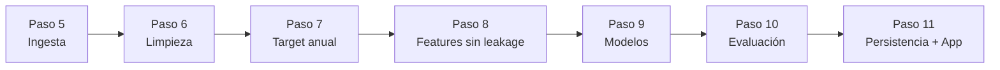

# 🧭 Guía Paso a Paso: de los CSV crudos a una app de Machine Learning

**Proyecto:** Clasificación de departamentos de CABA en *Gama Alta* vs. *Estándar* (BA Data 2001–2016)
**Materia:** Programación Avanzada — Licenciatura en Ciencia de Datos
**Formato:** guía de aprendizaje práctica. Cada paso tiene **objetivo → idea clave → qué hacer → cómo verificar → para pensar**.

> [!NOTE]
> Esta guía es la versión pedagógica y secuencial de [DOCUMENTACION.md](file:///Users/fer/Library/CloudStorage/GoogleDrive-f.galera.05@gmail.com/My%20Drive/z%20-%20Licenciatura/3er%20cuatrimestre%202-2026/03%20-%20Programacion%20avanzada/z%20-%20TP/taller_integrador/DOCUMENTACION.md), que queda como manual de referencia (teoría, esquemas de BD, glosario completo). Las cifras provienen de ese manual; verificá las tuyas al correr el pipeline.

---

## 0. Cómo usar esta guía

| Si querés… | Hacé esto | Tiempo estimado |
| :--- | :--- | :--- |
| **Entender el proyecto** | Leé los pasos 1–3 y los recuadros 💡 | 30 min |
| **Correrlo y ver resultados** | Pasos 4, 5 y 11 | 20 min (+ entrenamiento) |
| **Estudiarlo a fondo** | Todos los pasos en orden, con los ejercicios | 4–6 h |
| **Extenderlo** | Pasos 12–13 | 2 h |

**Convenciones:** 💡 idea clave · ⚠️ error común · ✅ checkpoint (verificá antes de seguir) · 🤔 pregunta para pensar.

**Al terminar vas a poder:**
- [ ] Explicar por qué se usa un umbral **por año** y no un precio fijo.
- [ ] Identificar y evitar el *data leakage* en un pipeline.
- [ ] Justificar por qué el Accuracy engaña con clases desbalanceadas.
- [ ] Leer una matriz de confusión y traducirla a decisiones de negocio.
- [ ] Reentrenar el modelo, guardarlo y consumirlo desde Streamlit.

---

## 1. El problema: qué resolvemos y por qué es difícil

**Objetivo:** entender el caso de negocio antes de escribir código.

**Pregunta central:** dado un departamento (m², ambientes, barrio, cochera…), ¿es de **Gama Alta** o **Estándar**?

Tres dificultades reales que el proyecto enfrenta:

1. **Datos heterogéneos:** 16 CSV (uno por año) con columnas renombradas, mala codificación (`BAÃOS`), y hasta latitud/longitud invertidas.
2. **El dólar no es una vara fija:** US$150.000 en 2002 era lujo; en 2016 era un dos ambientes común.
3. **Un notebook no es un producto:** se busca un pipeline reproducible + bases de datos + una app.

💡 **Idea clave:** el *target* no se descarga, **se construye**. Definir bien qué significa "Gama Alta" es la decisión más importante de todo el proyecto.

🤔 **Para pensar:** ¿qué pasaría si definieras "Gama Alta" como "más de US$200.000"? ¿Qué porcentaje de 2002 y de 2016 quedaría en cada clase?

---

## 2. El mapa del recorrido



| Etapa | Módulo | Entrada → Salida |
| :--- | :--- | :--- |
| Ingesta | `src/data_loader.py` | 16 CSV → 1 DataFrame (~178.241 filas) |
| Limpieza | `src/cleaning.py` | DataFrame → ~176.377 filas |
| Target | `src/cleaning.py` | + columna `ES_GAMA_ALTA` |
| Features | `src/features.py` | Tabla → `X`, `y` + `ColumnTransformer` |
| Modelado | `src/models.py` | Dummy, Regresión Logística, Random Forest |
| Evaluación | `src/evaluation.py` | Métricas + matriz de confusión |
| Persistencia | `src/db_sql.py`, `src/db_mongo.py` | SQLite + MongoDB |
| Entrega | `app/app.py` | Dashboard Streamlit |

💡 **Principios de diseño que vas a ver repetidos:**
- **Separación de responsabilidades:** cada módulo hace una sola cosa.
- **Fuente única de verdad:** rutas y constantes viven solo en `config.py`.
- **Degradación elegante:** si MongoDB no está, el pipeline sigue (solo avisa).

---

## 3. Estructura del repositorio

```
taller_integrador/
├── config.py            # rutas, columnas, mapeos (fuente única de verdad)
├── main.py              # orquesta el pipeline completo
├── requirements.txt
├── data/raw/            # 16 CSV originales (SOLO LECTURA)
├── data/inmuebles.db    # SQLite generada
├── src/                 # data_loader, cleaning, features, models,
│                        # evaluation, db_sql, db_mongo, visualization, logger_setup
├── notebooks/           # 01_eda.ipynb, 02_modelado.ipynb
├── app/                 # app.py + modelo_ganador.joblib
└── logs/                # pipeline.log + matriz_confusion_ganador.png
```

💡 `data/raw/` es **inmutable**: nunca se sobreescribe. Así cualquier experimento se puede repetir desde cero.

---

## 4. Paso 1 — Preparar el entorno

**Objetivo:** tener Python y las dependencias aisladas del resto de tu máquina.

```bash
cd taller_integrador
python3 --version            # 3.11 o 3.12
python3 -m venv .venv
source .venv/bin/activate    # Windows: .venv\Scripts\Activate.ps1
pip install --upgrade pip
pip install -r requirements.txt
```

✅ **Checkpoint:** el prompt empieza con `(.venv)` y `python -c "import pandas, sklearn, streamlit"` no da error.

⚠️ **Error común:** instalar con el Python global. Si luego aparece `ModuleNotFoundError`, casi siempre falta activar el entorno.

**Opcional – MongoDB:** no es obligatorio. Sin él, el pipeline guarda en SQLite y archivos locales. Para activarlo: `brew services start mongodb-community` (macOS) o `systemctl start mongod` (Linux).

---

## 5. Paso 2 — Explorar antes de limpiar (EDA)

**Objetivo:** conocer los datos *antes* de tocarlos.

```bash
jupyter lab      # abrí notebooks/01_eda.ipynb
```

Respondé mientras recorrés el notebook:
- ¿Cuántas filas hay por año? ¿Hay años con muchos menos datos?
- ¿Qué columnas tienen más nulos?
- ¿Cómo se distribuye `M2`? ¿Y `DOLARES`? ¿Hay colas largas?
- ¿Aparecen coordenadas fuera de CABA?

✅ **Checkpoint:** podés enumerar al menos 3 problemas de calidad del dataset.

💡 **Regla de oro:** el EDA genera *preguntas*; la limpieza, *reglas*. Cada filtro del paso 4 nace de algo que viste acá.

---

## 6. Paso 3 — Ingesta y unificación (`src/data_loader.py`)

**Objetivo:** pasar de 16 archivos distintos a un único DataFrame con esquema canónico.

**Qué hace:**
1. Lee cada CSV con `engine="python"` y `on_bad_lines` para **advertir y saltear** líneas corruptas sin abortar.
2. Renombra columnas con `COLUMN_RENAME_MAP` (en `config.py`): `LATITUD→LAT`, `BAÃOS/BAÑO→BAÑOS`, `M2CUB→M2_CUBIERTOS`…
3. Agrega las columnas faltantes como `NaN` y descarta las sobrantes.
4. Corrige coordenadas invertidas.

**La corrección geográfica, explicada:** CABA está cerca de lat ≈ −34,6 y lon ≈ −58,4. Como |−34,6| < |−58,4|, si en una fila `|LAT| > |LON|`, están cruzadas:

```python
swapped = lat.abs() > lon.abs()
df["LAT"] = np.where(swapped, lon, lat)
df["LON"] = np.where(swapped, lat, lon)
```

💡 Está **vectorizado** (`np.where` sobre toda la columna): sin bucles `for`, así es rápido en 178.000 filas.

✅ **Checkpoint:** el DataFrame unificado tiene ≈178.241 filas y 22 columnas.

🤔 **Para pensar:** ¿por qué usar `Path(__file__).resolve().parent` en `config.py` en vez de rutas relativas como `"data/raw"`?

---

## 7. Paso 4 — Limpieza y consistencia (`src/cleaning.py`)

**Objetivo:** quedarse con registros plausibles, sin tirar datos de más.

### 4.1 Filtro geográfico (`filter_caba_coordinates`)
Recuadro válido: `LAT ∈ [-34.72, -34.52]`, `LON ∈ [-58.54, -58.33]`.

| Situación de la fila | Decisión |
| :--- | :--- |
| Coordenadas dentro del recuadro | ✅ se conserva |
| Sin coordenadas pero con `BARRIO` | ✅ se conserva |
| Coordenadas fuera de CABA (o (0,0)) | ❌ se elimina |

### 4.2 Outliers y coherencia (`handle_missing_and_outliers`)
- Conversión segura: `pd.to_numeric(..., errors="coerce")`.
- Si falta `U_S_M2`: se recalcula como `DOLARES / M2`.
- Rangos plausibles:

| Variable | Rango |
| :--- | :--- |
| `M2` | 15 – 800 |
| `DOLARES` | 10.000 – 4.000.000 |
| `U_S_M2` | 200 – 15.000 |

- Texto: `BARRIO` en mayúsculas, sin espacios, nulos → `"DESCONOCIDO"`. `COMUNA` a entero 1–15.
- Amenidades (`COCHERA`, `BAULERA`, `LAVADERO`, `TERRAZA`) a 0/1.

### Balance de la limpieza

| Etapa | Entra | Sale | Descartadas |
| :--- | ---: | ---: | ---: |
| Filtro CABA | 178.241 | 177.980 | ~261 |
| Outliers | 177.980 | 176.377 | ~1.603 |

Se pierde ≈1,05 %: se eliminan las anomalías sin sacrificar volumen.

✅ **Checkpoint:** `df["M2"].min() >= 15` y `df["DOLARES"].max() <= 4_000_000`.

⚠️ **Error común:** elegir rangos mirando solo el modelo final. Los umbrales deben justificarse con el negocio (¿un depto de 1 m²? ¿una cochera cargada como depto?), no con la métrica.

---

## 8. Paso 5 — Construir el target sin sesgo temporal

**Objetivo:** crear `ES_GAMA_ALTA` de forma justa a lo largo de los años.

$$\text{Umbral}_t = Q_{0.75}(\text{U\_S\_M2}_t) \qquad \text{ES\_GAMA\_ALTA}_i = \mathbb{1}\left[\text{U\_S\_M2}_i \ge \text{Umbral}_{t(i)}\right]$$

```python
threshold_per_year = df.groupby("AÑO")["U_S_M2"].transform(lambda s: s.quantile(0.75))
df["ES_GAMA_ALTA"] = (df["U_S_M2"] >= threshold_per_year).astype(int)
```

💡 `.transform()` devuelve una serie **del mismo tamaño** que el DataFrame, con el umbral de cada año repetido en cada fila. Por eso se puede comparar fila a fila.

**Resultado:** 132.282 en clase 0 y 44.095 en clase 1 → **75 % / 25 %** (desbalanceado a propósito, por definición del percentil 75).

✅ **Checkpoint:** `df["ES_GAMA_ALTA"].mean()` ≈ 0,25 en todo el dataset y también dentro de cada año.

🤔 **Para pensar:** ¿qué ventaja tiene este enfoque frente a uno fijo? ¿Qué limitación introduce? *(Pista: siempre habrá exactamente ~25 % de "lujo", aunque el mercado se abarate.)*

---

## 9. Paso 6 — Guardar el dataset limpio (SQLite)

**Objetivo:** persistir el resultado curado para consultarlo con SQL.

El pipeline escribe la tabla `departamentos_limpios` en `data/inmuebles.db`. Probalo:

```bash
sqlite3 data/inmuebles.db "SELECT count(*) FROM departamentos_limpios;"
# ≈ 176377

sqlite3 data/inmuebles.db \
 "SELECT BARRIO, ROUND(100.0*AVG(ES_GAMA_ALTA),1) AS pct
  FROM departamentos_limpios GROUP BY BARRIO ORDER BY pct DESC LIMIT 5;"
```

💡 **Por qué SQL y NoSQL:** SQLite guarda datos **tabulares y estables** (el dataset, las predicciones). MongoDB guarda **documentos flexibles** (métricas, hiperparámetros, logs) cuya forma puede cambiar.

---

## 10. Paso 7 — Features sin *data leakage* (`src/features.py`)

**Objetivo:** armar `X` e `y` y un preprocesador reutilizable.

### 7.1 Eliminar lo que "delata" al target
`ES_GAMA_ALTA` se calculó con `U_S_M2` (que viene de `DOLARES / M2`). Si esas columnas quedaran en `X`, el modelo aprendería la fórmula y daría ~100 % **sin entender nada del mercado**.

> [!IMPORTANT]
> **Data leakage** = información del futuro (o del target) disponible al entrenar pero no al predecir. `split_features_and_target` excluye `DOLARES` y `U_S_M2` deliberadamente.

### 7.2 Partición estratificada
80 % train / 20 % test con `stratify=y`, `random_state=42` → ambos conjuntos mantienen la proporción 75/25. Test = 35.276 propiedades.

⚠️ **Orden correcto:** primero **separar**, después **ajustar** imputadores/escaladores *solo con train*. Ajustarlos con todo el dataset también es leakage.

### 7.3 `ColumnTransformer`

| Tipo | Columnas | Transformaciones |
| :--- | :--- | :--- |
| Numéricas | `M2`, `AMBIENTES`, `BAÑOS`, `ANTIGUEDAD`, amenidades | `SimpleImputer(median)` → `StandardScaler` |
| Categóricas | `BARRIO`, `COMUNA` | `SimpleImputer(most_frequent)` → `OneHotEncoder(handle_unknown="ignore")` |

- **Mediana** (no media): robusta a colas pesadas.
- **StandardScaler:** $z = (x-\mu)/\sigma$. Ej.: con μ=65 y σ=30, un depto de 155 m² tiene z=+3.
- **`handle_unknown="ignore"`:** un barrio nuevo en producción produce ceros en las dummies, en lugar de romper la app.

✅ **Checkpoint:** `X.columns` no contiene `DOLARES` ni `U_S_M2`.

🤔 **Para pensar:** si probaras agregar `DOLARES` a `X`, ¿qué F1 esperás? Probalo y comprobalo (ejercicio 3).

---

## 11. Paso 8 — Entrenar y comparar modelos (`src/models.py`)

**Objetivo:** comparar contra un piso, un modelo simple y uno potente.

| # | Modelo | Rol didáctico |
| :-: | :--- | :--- |
| 1 | `DummyClassifier(most_frequent)` | **Piso:** predice siempre "Estándar" |
| 2 | `LogisticRegression(class_weight="balanced")` | Baseline lineal, interpretable |
| 3 | `RandomForestClassifier` + `GridSearchCV` | Ensamble no lineal |

**`class_weight="balanced"`:** pondera cada clase inversamente a su frecuencia, $w_c = \frac{n}{k\cdot n_c}$. Equivocarse en Gama Alta cuesta ~3 veces más que en Estándar.

**`GridSearchCV`:**
```python
cv = StratifiedKFold(n_splits=3, shuffle=True, random_state=42)
param_grid = {"classifier__n_estimators": [50, 100],
              "classifier__max_depth": [10, 20]}
# scoring="f1_weighted"
```
- `StratifiedKFold` mantiene el 25 % de lujo en cada pliegue.
- El prefijo `classifier__` indica que el parámetro pertenece al paso `classifier` del `Pipeline`.
- El proyecto selecciona al ganador por **F1 ponderado**.

**Ganador reportado:** `RandomForest_Tuned` (`max_depth=20`, `n_estimators=100`), F1 ponderado = 0,8013.

💡 **Cómo funciona Random Forest:** muchos árboles, cada uno entrenado con una muestra *bootstrap* y un subconjunto aleatorio de columnas; la predicción promedia los votos. Reduce la varianza de un árbol individual.

⚠️ **Si tu PC es lenta:** reducí la muestra del `GridSearchCV` o la grilla (`n_estimators: [50]`).

---

## 12. Paso 9 — Evaluar: leer números, no solo mirarlos

**Matriz de confusión del test (35.276 filas):**

| | Predice Estándar | Predice Gama Alta |
| :--- | :---: | :---: |
| **Real Estándar** | VN = 21.299 | FP = 5.133 |
| **Real Gama Alta** | FN = 2.183 | VP = 6.661 |

| Métrica | Cálculo | Valor | Lectura |
| :--- | :--- | :---: | :--- |
| Accuracy | (6.661+21.299)/35.276 | 79,26 % | Aciertos totales |
| Precision (Alta) | 6.661/(6.661+5.133) | 56,48 % | Cuando dice "lujo", acierta poco más de la mitad |
| Recall (Alta) | 6.661/(6.661+2.183) | 75,32 % | Detecta ~3 de cada 4 lujos reales |
| F1 (Alta) | 2·P·R/(P+R) | 64,55 % | Equilibrio P/R en la clase minoritaria |
| ROC-AUC | — | 85,56 % | Prob. de rankear un lujo por encima de un estándar |

### La trampa del Accuracy
El Dummy obtiene **74,93 %** de Accuracy (26.432/35.276) con **0 %** de Recall en lujo. Nuestro 79,26 % parece poco mejor, pero el valor real está en detectar la clase minoritaria.

### Traducción al negocio
- **Falso Positivo** → *sobretasar*: la propiedad queda meses sin venderse.
- **Falso Negativo** → *oportunidad perdida/ganga*: algo valioso clasificado como accesible.

💡 Qué error pesa más depende del negocio: una inmobiliaria quizá prefiera evitar FP; un inversor, minimizar FN.

⚠️ **Nota sobre las métricas ponderadas:** la Precision/F1 ponderadas (82,12 % / 80,13 %) promedian ambas clases y quedan "infladas" por la clase mayoritaria. Para la clase de interés mirá siempre las métricas **por clase**.

✅ **Checkpoint:** recalculá Precision y Recall de Gama Alta a mano desde la matriz y comprobá que coinciden con las del reporte.

---

## 13. Paso 10 — Ejecutar todo de punta a punta

```bash
python main.py
```

Verás 8 etapas con logs:

| Etapa | Qué ocurre |
| :-: | :--- |
| 1 | Carga y unifica los 16 CSV |
| 2 | Limpieza + target |
| 3 | Guarda en SQLite |
| 4 | Split 80/20 estratificado |
| 5 | Construye el `ColumnTransformer` |
| 6 | Entrena Dummy, Logística y Random Forest (con grid) |
| 7 | Compara en test y elige ganador |
| 8 | Guarda resultados en MongoDB (si hay) y el modelo en `app/modelo_ganador.joblib` |

✅ **Checkpoints finales:**
```bash
ls -lh app/modelo_ganador.joblib      # existe
tail -n 20 logs/pipeline.log          # sin errores
ls logs/matriz_confusion_ganador.png  # gráfico generado
```

**Reproducibilidad:** `random_state=42` en split, CV y modelos → mismos resultados en cualquier máquina.

**Logging profesional** (`src/logger_setup.py`): consola + `logs/pipeline.log` rotativo (2 MB, 3 backups) + colección `logs` en MongoDB si está disponible.

---

## 14. Paso 11 — Usar el modelo desde la app

```bash
streamlit run app/app.py     # http://localhost:8501
```

| Pestaña | Qué hace |
| :--- | :--- |
| **1. Simulador** | Armás un depto → `predict()` + `predict_proba()` → segmento y % de certeza |
| **2. Métricas** | Tarjetas de métricas + matriz de confusión |
| **3. Bases de datos** | Visor de SQLite y MongoDB, sin clientes externos |

**Ejemplo de lectura:** `predict_proba → [0.126, 0.874]` ⇒ 87,4 % de ser Gama Alta; como ≥ 0,50 se etiqueta *Gama Alta*.

💡 La app **no reentrena**: solo carga el `Pipeline` serializado con `joblib`, que ya incluye el preprocesamiento. Por eso recibe datos "crudos" y funciona igual que en entrenamiento.

🤔 **Para pensar:** ¿qué pasa si ingresás un barrio inexistente? *(Mirá `handle_unknown="ignore"`.)*

---

## 15. Paso 12 — Extender el proyecto

### Agregar una variable (ej. `ORIENT`)
1. Verificá que exista en las columnas de `config.py`.
2. Agregala a `DEFAULT_CATEGORICAL_FEATURES` en `src/features.py`.
3. Agregá `st.selectbox("Orientación", [...])` en `app/app.py`.
4. **Reentrenar** (`python main.py`): el `.joblib` viejo no conoce la columna nueva.

### Probar otro algoritmo (ej. XGBoost)
1. `pip install xgboost`
2. Crear un `Pipeline([("preprocessor", pre), ("classifier", XGBClassifier(...))])` en `src/models.py`.
3. Sumarlo a los candidatos en `main.py`; `compare_models` lo evaluará.

---

## 16. Paso 13 — Laboratorio: ejercicios

### 🟢 Nivel 1 — Exploración
1. Escribí una consulta SQL con los 5 barrios con mayor % de Gama Alta.
2. Cambiá el percentil a `0.80`. ¿Cómo cambian el balance de clases y las métricas?

### 🟡 Nivel 2 — Modelado
3. **Provocá leakage a propósito:** agregá `U_S_M2` a `X`. Observá el F1, explicá por qué es engañoso y revertí.
4. Cambiá la imputación numérica a `mean`. ¿Qué cambia?
5. Agregá **Especificidad** $= \frac{VN}{VN+FP}$ a `src/evaluation.py`.

### 🔴 Nivel 3 — Ingeniería
6. Creá `RATIO_M2_AMBIENTE = M2 / AMBIENTES` (cuidado con la división por cero) y medí su impacto.
7. Escribí tests con `pytest`: sin nulos en `ES_GAMA_ALTA`, coordenadas dentro del recuadro de CABA, y `DOLARES`/`U_S_M2` ausentes de `X`.
8. Ajustá el umbral de decisión (0,5 → 0,4) y analizá el trade-off Precision/Recall.

---

## 17. Solución de problemas

| Síntoma | Causa probable | Solución |
| :--- | :--- | :--- |
| `FileNotFoundError ... departamentos-en-venta-2008.csv` | Falta un CSV anual | Colocarlo en `data/raw/` con el nombre exacto |
| `ModuleNotFoundError: No module named 'src'` | Ejecutás desde otra carpeta | Correr desde la raíz del proyecto |
| `ModuleNotFoundError` de una librería | Entorno no activado | `source .venv/bin/activate` |
| Entrenamiento lentísimo / `MemoryError` | Grilla o muestra muy grande | Reducir grilla o `sample_size` |
| `Warning: MongoDB no disponible` | Servicio apagado | No bloquea. Iniciar `mongod` si lo querés |
| La app falla al cargar el modelo | Falta el `.joblib` | Correr `python main.py` primero |

---

## 18. Checklist final de autoevaluación

- [ ] Puedo explicar el flujo de punta a punta sin mirar la guía.
- [ ] Sé por qué `DOLARES` y `U_S_M2` no están en `X`.
- [ ] Sé por qué se hace el split **antes** de ajustar el preprocesamiento.
- [ ] Calculé a mano Precision, Recall y F1 desde la matriz.
- [ ] Puedo argumentar cuándo conviene SQLite y cuándo MongoDB.
- [ ] Reentrené el modelo con un cambio propio y lo vi reflejado en la app.

---

## 19. Glosario express

| Término | Significado breve |
| :--- | :--- |
| **Baseline** | Modelo simple de referencia para saber si uno complejo aporta valor |
| **Data leakage** | Información del target/futuro filtrada al entrenamiento |
| **ColumnTransformer** | Aplica transformaciones distintas por columna |
| **Pipeline** | Encadena preprocesamiento + modelo en un solo objeto |
| **Imputación** | Reemplazar nulos por mediana/moda/etc. |
| **One-Hot** | Texto → columnas 0/1 sin orden implícito |
| **Hiperparámetro** | Configuración que no se aprende de los datos |
| **Stratified K-Fold** | Validación cruzada que preserva la proporción de clases |
| **Ensamble** | Combinación de muchos modelos |
| **ROC-AUC** | Capacidad de discriminar clases en todos los umbrales (0,5 = azar) |
| **Percentil** | Valor bajo el cual cae cierto % de observaciones |

> Para teoría ampliada (sigmoide, log-loss, Gini), esquemas completos de las tablas SQLite y colecciones de Mongo, consultá [DOCUMENTACION.md](file:///Users/fer/Library/CloudStorage/GoogleDrive-f.galera.05@gmail.com/My%20Drive/z%20-%20Licenciatura/3er%20cuatrimestre%202-2026/03%20-%20Programacion%20avanzada/z%20-%20TP/taller_integrador/DOCUMENTACION.md).

